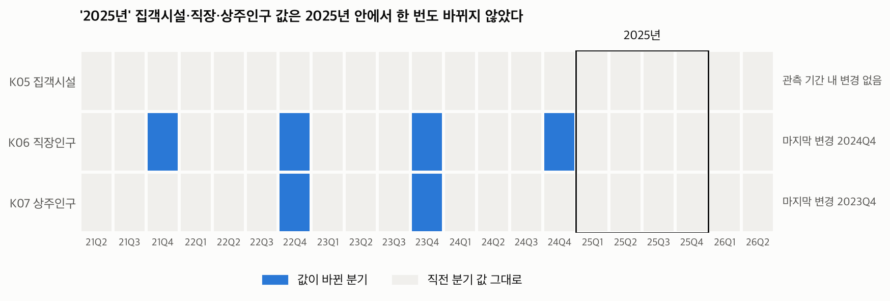
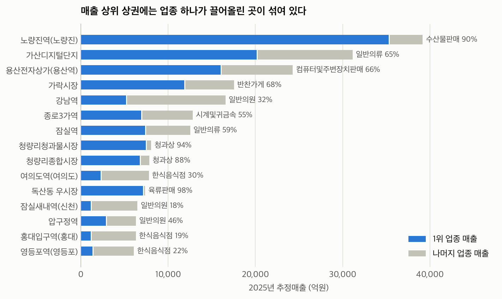
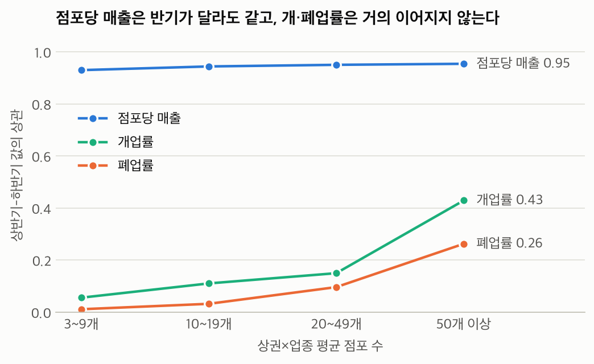

# 서울 상권 EDA (2025년) · 김지영

상권 점수화(STEP 3~5)를 시작하기 전에 데이터가 실제로 무엇을 담고 있고 어떤 지표를 믿을 수 있는지 확인한 탐색적 분석입니다. 코드와 근거는 [eda.ipynb](eda.ipynb)에 있습니다.

- 범위: 서울특별시 2025년. 상가정보(S01)와 서울시 상권분석서비스(K01~K07)
- 원본 데이터(`data/raw/`)는 읽기만 했습니다.
- 모든 관계는 상관이며 인과가 아닙니다.
- **칸**은 상권×업종 조합 하나를 뜻합니다.

## 핵심 결과

### 1. 매출 데이터가 없는 구간이 있습니다

매출 행은 점포 3개 이상인 칸에만 있습니다. 62개 업종 칸의 48.8%는 점포 0~2개라 매출 행이 없고, 62개 중 19개 업종은 매출 칸에 속한 점포가 절반도 안 됩니다. 부동산중개업은 5.9%입니다. 매출이 0인 것이 아니라 정보가 없는 것이므로 0으로 채우면 안 됩니다.

### 2. '2025년' 값이 2025년에 바뀌지 않은 데이터가 있습니다



| 데이터 | 마지막으로 값이 바뀐 분기 |
|---|---|
| K05 집객시설 | 없음 (2021Q1~2026Q2 내내 같음) |
| K06 직장인구 | 2024Q4 |
| K07 상주인구 | 2023Q4 |

분기별 변수로 쓰면 같은 값이 네 번 반복됩니다. 상권별 고정 속성으로 한 번만 붙이고 실제 시점을 명시해야 합니다.

### 3. 관광특구는 합계에서 빼야 합니다

관광특구 상가의 97.1%가 다른 상권에도 속합니다. 상가 좌표로 확인한 겹침은 모두 관광특구와 다른 상권 사이에서 생깁니다. 관광특구를 빼면 서울 매출 합계가 92.7조원에서 87.0조원으로 줄어듭니다. 그 밖에 서울 상가의 20.4%는 어떤 상권에도 속하지 않습니다.

### 4. 상권 총매출 순위는 입지보다 업종을 보여 줍니다



상위 15개 중 9곳은 업종 하나가 매출의 50%를 넘습니다. 노량진역은 수산물판매가 90%입니다. 점수는 희망 업종 안에서 비교해야 합니다.

### 5. 칸 단위 폐업률은 1년치로 믿기 어렵습니다



- 점포당 매출의 상·하반기 상관은 0.93~0.95인데 폐업률은 0.01~0.26입니다.
- 칸의 72.9%가 점포 5개 미만이라, 그대로 계산한 폐업률 상위 100칸은 작은 칸의 우연입니다. 축소 추정을 적용하면 상위 100칸 중 2칸만 남습니다.
- 상권 단위로 묶으면 점포 300개 이상 상권에서 0.42까지 올라갑니다.
- 자치구 단위에서는 매출 지수와 폐업비의 상관이 -0.61로 드러납니다. 상권 단위는 -0.13입니다.

`clsbiz_rt` 컬럼도 그대로 쓰면 안 됩니다. 마지막 점포가 문을 닫은 칸(점포 0개)의 폐업률이 0으로 기록되어 있습니다.

### 6. 점포 수를 그대로 경쟁 감점으로 쓰면 안 됩니다

같은 업종 점포가 2배인 칸의 폐업률은 1.004배(95% 구간 0.990~1.019)로 차이가 없습니다. 칸 매출의 점포 수 탄력성은 1.19로, 점포가 많은 칸의 점포당 매출이 오히려 높습니다. 상권과 업종을 고정해도 같습니다.

**점포가 많을수록 좋다는 뜻은 아닙니다.** 장사가 되는 곳에 점포가 몰린다는 설명도 똑같이 성립합니다. 경쟁 위험은 수요 대비 공급으로 다시 설계하는 것을 제안합니다.

### 7. 유동인구 하나로 수요를 대표할 수 없습니다

업종을 보정한 매출 지수와의 Spearman 상관입니다.

| 지표 | 상권 합계 | 면적당 밀도 |
|---|---|---|
| 유동인구 | -0.13 | -0.15 |
| 직장인구 | +0.27 | +0.40 |
| 상주인구 | -0.28 | -0.40 |

추정매출이 카드사 자료 기반이라 직장인 결제가 많은 상권이 높게 잡혔을 가능성도 있습니다.

## 팀 결정이 필요한 사항

| 사항 | 제안 | 근거 |
|---|---|---|
| 분석 기간 (계획서 7장 1번) | K01·K02의 2024년 자료를 추가합니다 | 성장률 계산이 가능해지고 폐업률 관측 기간도 늘어납니다 |
| 스냅숏 정렬 (2번) | S01을 2025Q4에 맞춥니다 | 상권별 점포 수 순위가 Spearman 0.97로 일치합니다 |
| 업종 매핑 (3번) | 서울 서비스업종 100개를 기준으로 삼고 S01은 보조로 씁니다 | 매출·개폐업이 이 체계이고, 이름 매핑은 업종별 Spearman 0.75~0.97로 편차가 큽니다 |
| 점포 0~2개 칸 (신규) | 결측으로 두고 "매출 미공개"로 표시합니다 | 근거 없는 점수를 만들지 않습니다 |
| K05~K07 시점 (신규) | 고정 속성으로 쓰고 서울신용보증재단에 문의합니다 | 포털의 갱신 안내와 실제 값이 다릅니다 |
| 전자상거래업 (신규) | 추천 대상에서 제외합니다 | 폐업 20.2%, 개업 0.6%로 이상하고 점포 입지와 관련이 약해 보입니다 |

STEP별 처리 목록은 노트북 7장에 있습니다.

## 파일

| 경로 | 내용 |
|---|---|
| [eda.ipynb](eda.ipynb) | 실행 결과가 포함된 노트북. 그림 17개와 해석 |
| [figures/](figures/) | 그림 PNG |
| [tables/industry_summary.csv](tables/industry_summary.csv) | 100개 업종 요약 |
| [tables/trdar_summary.csv](tables/trdar_summary.csv) | 관광특구를 뺀 1,644개 상권 요약 |
| [tables/gu_summary.csv](tables/gu_summary.csv) | 25개 자치구 요약 |
| [requirements.txt](requirements.txt) | 실행에 필요한 패키지 |

## 다시 실행하기

`data/raw/`가 있어야 합니다. 없으면 [DATA_HANDOFF.md](../docs/DATA_HANDOFF.md) 11장을 참고하세요.

```bash
cd seoul-commercial-analysis
python3 -m venv .venv
.venv/bin/pip install -r 김지영/requirements.txt
.venv/bin/jupyter lab 김지영/eda.ipynb
```

전체 실행에 1~2분 걸립니다. 노트북은 `figures/`와 `tables/`의 파일을 다시 씁니다.

## 출처

서울특별시, 서울시 상권분석서비스 / 소상공인시장진흥공단, 상가(상권)정보


## Codex 대시보드

[marimo 대시보드 실행 안내](dashboard/README.md)에서 EDA·STEP 2·3 자료를 업종·분기·지역별로 살펴볼 수 있습니다.

## Claude 대시보드

[상권 탐색기 실행 안내](claude_dashboard/README.md)에서 희망 업종별 상권 지도와 비교표를 보고, 지표의 신뢰도와 데이터 시점을 함께 확인할 수 있습니다.
