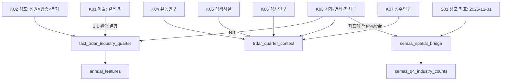

# STEP 2. 데이터 전처리 및 결합 설계

작성일: 2026-10-31 · 범위: 서울시 2025년 · 상태: 설계 및 원본 기반 구현·실행 완료

[EDA 보고서](eda%28Codex%29.md)의 결과를 바탕으로 실제 분석에 사용할 테이블을 만들었다. 기준 업종은 서울시 서비스업종 100개이며, 매출은 이 중 62개 업종에만 있다. 소상공인 업종 247개는 별도 체계로 유지했다. 원본과 기존 EDA는 수정하지 않았다.

## 1. 이번 단계의 결정

| 항목 | 적용한 기준 | 이유 |
| --- | --- | --- |
| 핵심 분석 단위 | 상권×서울 서비스업종×분기 | 매출·점포·개폐업의 기준을 맞춤 |
| 기준 테이블 | K02 점포 자료에 실제 존재하는 행 | 매출 행이 없는 칸도 보존 |
| 기준 기간 | 2025Q1~Q4 | 수집 범위 유지 |
| 상가정보 시점 | 2025-12-31를 2025Q4 보조 자료로 사용 | 점포별 분기 이력을 만들 수 없음 |
| 관광특구 | 저장은 보존, 주요 분석에서는 제외하는 플래그 적용 | 다른 상권과의 공간 중복 방지 |
| 서울 업종과 소상공인 업종 | 승인 매핑 전까지 별도 분석 | 분류 체계와 포함 범위가 다름 |
| 인구·시설 | 별도의 상권×분기 테이블 | 업종마다 같은 인구를 더하는 오류 방지 |
| 소규모 기준 | 점포 5개 미만을 표시 | 비율 지표의 작은 분모 주의. 분석 행은 삭제하지 않음 |
| 업종 비교 최소 집단 | 30ㅌ개 적격 칸 | 중앙값 비교의 운영 기준. 실증적으로 최적화한 임계값 아님 |

## 2. 결합 구조



**주 분석 fact와 수요 context는 분리 저장한다.** 모델 입력용으로 펼칠 때만 `quarter + trdar_code`로 N:1 결합한다. 펼친 뒤 업종별로 인구를 합산하면 같은 사람·시설을 반복 더하게 된다. 지역별 인구 합계는 반드시 context에서 구한다.

## 3. 입력 자료와 컬럼 표준화

입력 경로와 출처는 [인수인계 문서](../docs/DATA_HANDOFF.md), 전체 원본 컬럼 설명은 [원본 데이터 사전](../data/metadata/data_dictionary.csv)에 있다. 파일의 실제 숫자를 분석한 것이며, 이번 작업에서 포털의 현재 명세나 공개 정책을 새로 검증하지 않았다.

| 자료 | 원본 컬럼 | 표준 컬럼·처리 |
| --- | --- | --- |
| K01 | 기준_년분기_코드, 상권_코드, 서비스_업종_코드 | quarter, trdar_code, industry_code: 문자열 |
| K01 | 당월_매출_금액, 당월_매출_건수 | sales_amount, sales_count: 분기 금액·건수 |
| K01 | 주중·주말_매출_금액 | weekday_sales, weekend_sales |
| K01 | 시간대_00~06_매출_금액 등 | time_00_06_sales 등 6개 |
| K01 | 시간대_건수~06_매출_건수 등 | time_00_06_count 등: 원본에서 깨진 6개 헤더를 대응표로 수정 |
| K01 | 남성·여성·연령대별 매출 금액 | male_sales, female_sales, age_10_sales~age_60_plus_sales |
| K02 | stdr_yyqu_cd, trdar_cd, svc_induty_cd | quarter, trdar_code, industry_code |
| K02 | similr_induty_stor_co | store_count: 일반+프랜차이즈 전체 점포 |
| K02 | stor_co, frc_stor_co | independent_store_count, franchise_store_count |
| K02 | opbiz_stor_co, clsbiz_stor_co | open_count, close_count |
| K02 | opbiz_rt, clsbiz_rt | reported_open_rate, reported_close_rate: 원본 보존 |
| K03 | TRDAR_CD, TRDAR_CD_N | trdar_code, trdar_name: 이름은 경계 자료 기준 |
| K03 | SIGNGU_CD, SIGNGU_CD_, ADSTRD_CD, ADSTRD_CD_ | 자치구·행정동 코드 및 이름. 코드 조인의 대체 키로 쓰지 않음 |
| K03 | RELM_AR, geometry | reported_area_m2 보존, 수리한 도형으로 area_m2 산출 |
| K04~K07 | 총_유동인구_수, 집객시설_수, 총_직장_인구_수, 총_상주인구_수 | floating_population, facility_count, worker_population, resident_population |
| S01 | 상가업소번호, 소분류코드, 좌표 | store_id, semas_industry_code, 경도·위도 |

명칭은 표시용이며 결합 키로 사용하지 않는다. 코드는 숫자처럼 보이더라도 문자열로 읽어 자릿수를 보존한다. 숫자 컬럼은 오류를 무시하지 않고 변환하며, 잘못된 값이 있으면 실행을 중단한다. K01의 분석에 필요한 금액·시간대 건수 컬럼을 선택 보존했으며 원본 전체 55개 컬럼을 복제한 테이블은 아니다.

## 4. 결측·이상치·중복 처리

| 상황 | 처리 | 쉬운 설명 |
| --- | --- | --- |
| 매출 대상이 아닌 업종 | sales_status=unsupported_industry | 이 업종에는 매출 자료 자체가 없음 |
| 대상 업종인데 해당 칸에 매출 행 없음 | sales_status=missing_cell | 해당 상권·업종·분기의 자료가 안 보임 |
| 매출 행 있음 | sales_status=observed | 0원도 실제 관측이면 관측으로 구분 |
| K02에도 없는 조합 | 주 fact에 임의 생성하지 않음 | 없는 행을 점포 0개라고 추정하지 않음 |
| 인구·시설 행 없음 | 수치 결측+K04~K07_row_present=False | 자료 부재와 실제 0을 구분 |
| 분모 0 또는 결측 | 비율 결측 | 0개 점포로 나눈 매출을 만들지 않음 |
| 집객시설 세부 항목 공백 | 공백 유지+누락 항목 수 기록 | 근거 확인 없이 0개로 치환하지 않음 |
| 원본 개폐업률 100 초과 | 원본 보존+건수 기반 보조 비율 | 확률로 해석하지 않으며 100에 잘라 맞추지 않음 |
| 매출 극단값 | 원본 수치 유지 | 점수화 단계 전 임의 삭제·윈저화하지 않음 |
| 키 중복·필수 키 결측 | 검증 실패 시 중단 | 첫 행만 남기는 식으로 문제를 숨기지 않음 |
| 시간 차분의 전분기 부재 | 증감률 결측 | 1분기의 전분기를 4분기로 잘못 연결하지 않음 |
| 일부 분기 매출 없음 | 관측합만 보존, 완전 연매출은 결측 | 반년 매출을 1년 매출로 착각하지 않음 |

매출 없음의 사유는 파일에서 관측 가능한 범위로만 분류했다. `missing_cell`을 공식적인 개인정보 비공개 사유라고 단정하지 않는다. 결측은 추천 불가능·불량 상권과 같은 뜻도 아니다.

## 5. 공간 결합과 업종 매핑

### 공간 결합

1. S01의 경도·위도를 숫자로 읽고 지구상의 유효 범위를 검사한다.
2. WGS84(EPSG:4326) 점을 K03의 EPSG:5181로 변환한다. 위도·경도를 미터 좌표에 직접 붙이지 않는다.
3. K03의 유효하지 않은 도형은 가공 메모리에서 `make_valid()`로 수리한다. 원본 SHP는 보존한다.
4. `within`으로 상권 내부 점만 연결한다. 경계선 위의 점은 제외될 수 있어 `outside_or_boundary`로 표시한다. 최근접 상권에 억지로 배정하지 않는다.
5. 관광특구와 다른 상권의 중복을 포함한 모든 연결은 bridge에 남긴다. `store_id+match_number`가 저장 키다.
6. 보조 점포 집계에서는 관광특구를 빼고, 비관광 상권에 2개 이상 연결된 점포는 집계에서 제외한다. 그런 점포가 있더라도 bridge에서 확인할 수 있다.
7. 어느 상권에도 연결되지 않은 점포도 bridge에 보존한다. 서울 밖 점포라는 뜻이 아니라 수집한 상권 경계에 포함되지 않았다는 뜻이다.

면적은 수리한 도형의 ㎡ 값을 사용한다. 원본 `RELM_AR`는 비교용으로 보존했다. 행정동 코드는 분동·상권 대표 행정동 문제로 공간 조인 대신 사용하지 않는다.

### 업종 매핑

[매핑 검토표](step2_3/industry_mapping_review.csv)는 S02의 247개 코드로 만들었다. 모든 행은 `pending_review` 상태이며 자동 승인하지 않았다. [서울 업종 참조표](step2_3/seoul_industry_reference.csv)의 100개 코드와 범위·정의를 비교해 검토해야 한다.

| 필드 | 작성 기준 |
| --- | --- |
| semas_industry_code / name | 원본 분류. 수정하지 않음 |
| seoul_industry_code | 정의가 대응하는 서울 코드. 없으면 공백 유지 |
| mapping_status | pending_review / approved / rejected / needs_split |
| mapping_relation | one_to_one / many_to_one / one_to_many / no_match |
| rationale | 이름뿐 아니라 포함·제외 범위를 비교한 근거 |
| reviewer / review_date | 검토자와 검토일 |

소상공인 여러 코드가 서울 코드 하나에 대응하면 승인된 코드의 점포 수를 합산할 수 있다. 소상공인 코드 하나가 서울 여러 업종에 걸치면 점포별 추가 분류 근거 없이 복제·균등 배분하지 않는다. `needs_split`으로 남긴다. 검토표를 재실행으로 덮어쓰지 않으며, **현재 전처리 코드는 이 매핑을 실제 적용하지 않는다.** 승인 후 적용 코드를 별도 구현·검증해야 한다.

## 6. 시점 정렬과 중복 합산 방지

- 유동인구는 2025년 해당 분기를 연결한다. 시설·직장·상주인구도 제공 파일의 해당 분기 행을 보존하되, 실제 통계 시점을 확인했다는 뜻으로 표시하지 않는다.
- `*_last_observed_change`는 값이 마지막으로 달라진 제공 분기다. 실제 조사일이 아니며, `*_reference_time_status`로 2025년 내 변화 여부를 표시한다.
- 시설·직장·상주인구가 네 분기 반복된다고 관측 정보가 네 배가 된 것은 아니다. 연간 단면 분석에서는 한 번만 쓰거나 동일함을 확인한 후 대표 분기로 선택한다.
- 근거 시점이 다른 직장·상주·유동인구를 합쳐 ‘총 잠재고객’이나 ‘직장인 비율’을 만들지 않는다. 서로 다른 개념과 단위가 섞이기 때문이다.
- S01 점포 수는 Q4 보조 자료에만 존재한다. 이를 Q1~Q3의 실제 경쟁 점포 수로 복제하지 않는다.
- 이번 산출물은 사후 설명용이다. 2025년 초 시점의 예측 모델에 쓰려면 발표·수집 시점과 당시 이용 가능했던 경계를 별도로 확인해야 한다.

## 7. 산출 테이블

모든 CSV는 UTF-8 BOM, 대용량 데이터는 gzip 압축이다. 코드 컬럼은 읽을 때 반드시 문자열로 지정한다. 키·타입·결측 수는 [전체 스키마](step2_3/table_schema.csv)에 있다.

| 파일 | 한 행의 뜻 | 기본 키 | 용도 |
| --- | --- | --- | --- |
| [dim_trdar](step2_3/data/dim_trdar.csv.gz) | 상권 하나 | trdar_code | 이름·구분·자치구·면적·관광특구 플래그 |
| [fact_trdar_industry_quarter](step2_3/data/fact_trdar_industry_quarter.csv.gz) | 상권×서울 업종×분기 | quarter,trdar_code,industry_code | 점포·매출·개폐업·업종 내 비교 |
| [trdar_quarter_context](step2_3/data/trdar_quarter_context.csv.gz) | 상권×분기 | quarter,trdar_code | 수요·시설·상권 업종 다양성. 1,650상권×4분기 틀 |
| [annual_features](step2_3/data/annual_features.csv.gz) | 상권×서울 업종×연도 | year,trdar_code,industry_code | 네 분기 완전 관측 연간 지표 |
| [semas_spatial_bridge](step2_3/data/semas_spatial_bridge.csv.gz) | 점포의 공간 연결 한 건 | store_id,match_number | 미배정·중복·관광특구를 포함한 추적 |
| [semas_q4_industry_counts](step2_3/data/semas_q4_industry_counts.csv.gz) | 상권×소상공인 업종×Q4 | quarter,trdar_code,semas_industry_code | 별도 업종 체계의 공간 점포 집계 |

context의 전체 상권 틀과 달리 fact는 관측된 K02 행만 가진다. 두 테이블의 행 수가 다른 것은 의도한 설계다. 보조 집계에 행이 없는 경우도 원자료 범위와 공간 배정 여부를 확인한 뒤 처리한다.

## 8. 실행과 활용

```bash
cd seoul-commercial-analysis
.venv/bin/python 김지영/step2_3/build_features.py
.venv/bin/python 김지영/step2_3/verify_outputs.py
```

기존 프로젝트 가상환경의 pandas, numpy, geopandas로 실행한다. 패키지 버전·입력/출력 SHA-256·가정·실행 결과는 [manifest.json](step2_3/manifest.json)에 기록한다. 원본 경로가 같으면 작업 디렉터리와 관계없이 실행할 수 있다. 재실행은 해당 STEP 2·3 데이터와 QA 파일을 갱신하므로 검토를 마친 결과를 별도로 보관하려면 먼저 복사한다.

```python
from pathlib import Path
import pandas as pd

base = Path('김지영/step2_3/data')  # seoul-commercial-analysis에서 실행
fact = pd.read_csv(base / 'fact_trdar_industry_quarter.csv.gz',
                   dtype={'quarter': str, 'trdar_code': str, 'industry_code': str})
context = pd.read_csv(base / 'trdar_quarter_context.csv.gz',
                      dtype={'quarter': str, 'trdar_code': str})
# 예: 주 분석용 상권×업종 테이블에 수요 3개를 연결
model_input = fact.loc[fact['main_analysis_eligible']].merge(
    context[['quarter', 'trdar_code', 'floating_population',
             'worker_population', 'resident_population']],
    on=['quarter', 'trdar_code'], how='left', validate='many_to_one')
# model_input의 인구를 업종별 행 전체에 걸쳐 더하지 않는다.
```

## 9. 검증 결과와 남은 확인 사항

실행 수치와 검증 요약은 [실행 결과](step2_3/실행결과.md)에 정리했다. 자동 검증은 키 중복·널, 조인 후 행 수, 점포 구성 합계, 음수·무한대, 전체 매출 보존, 0 분모 처리, 1분기 차분, 불완전 연도 처리, 공간 연결 후 점포 보존을 확인한다.

남은 외부 확인은 기관 간 업종 대응 승인, 시설 세부 공백과 집객시설 총수 정의, 인구·시설의 실제 통계 작성 시점, 상권 경계의 역사적 유효 기간이다. 이를 확인하기 전에도 서울 기준의 기술 통계와 파생변수 분석은 진행할 수 있다. STEP 4의 최종 점수·가중치는 아직 만들지 않았다.

출처: 서울특별시 상권분석서비스 / 소상공인시장진흥공단 상가(상권)정보.
