# 서울 상권 EDA 재분석 (Codex)

작성일: 2026-10-31 · 분석 대상: 저장된 2025년 원본 · 분석 단위: 상권×업종×분기

기존 [클로드 EDA](README.md)를 참고해 확인할 질문을 정한 뒤, 원본 CSV와 상권 경계를 별도 코드로 다시 읽고 계산했다. 기존 요약 CSV와 그림을 재사용하지 않았다. 이 보고서는 **31개 시각화**와 그림별 읽는 방법·결과·주의점을 담았다. 원본과 기존 분석 파일은 수정하지 않았다.

## 먼저 알아둘 결과

- 관광특구를 뺀 2025년 관측 추정매출 합계는 **86.97조원**이다. 서울 전체 업종의 실제 매출 합계가 아니다.
- 점포 자료는 **100개 업종**, 매출 자료는 **62개 업종**을 담고 있다. 매출이 보이지 않는 칸을 0원으로 채우면 안 된다.
- 매출 대상 62개 업종 칸 중 **65.4%**는 매출 행이 없다. 관측 범위가 업종마다 다르므로 단순 매출 순위만으로 추천하기 어렵다.
- 점포당 월 환산 매출은 전체 관측 칸의 중앙값이 **753만원**, 평균이 **2,060만원**이다. 큰 값의 영향을 줄여 보려면 중앙값도 함께 봐야 한다.
- 4개 분기에 모두 매출이 있는 동일 조합 19,863개의 4분기 매출 지수는 **108.5**다(1분기=100). 1년 자료만으로 장기 성장이라고 부르기 어렵다.

## 자료와 전처리

자료 설명은 [데이터 인수인계 문서](../docs/DATA_HANDOFF.md), 파일별 출처·수집 기록은 [데이터 카탈로그](../data/metadata/data_catalog.csv)에 있다. 이번 분석은 저장된 파일의 내용에 대한 재분석이며, 포털의 현재 자료나 공식 공개 정책을 새로 확인한 것은 아니다.

| 데이터 | 행수_전체파일 | 열수 | 2025행수 | 중복키 | 결측셀 |
| --- | --- | --- | --- | --- | --- |
| 매출 | 85732 | 55 | 85732 | 0 | 0 |
| 점포 | 304775 | 14 | 304775 | 0 | 0 |
| 유동인구 | 6595 | 27 | 6595 | 0 | 0 |
| 직장인구 | 36027 | 26 | 6564 | 0 | 0 |
| 상주인구 | 35908 | 29 | 6532 | 0 | 0 |
| 집객시설 | 34716 | 25 | 6312 | 0 | 563750 |

행·열 수는 읽어온 원본 기준이며 결측셀은 전체 제공 기간 기준이다. 집객시설·직장·상주인구 파일은 여러 연도를 포함하므로 실제 수요 결합에는 2025년만 골랐다. 결측이 있는 시설의 세부 항목을 임의로 0으로 채우지 않았다.

| 처리 | 적용한 기준 |
| --- | --- |
| 기간 | 2025Q1~Q4, 상가정보는 2025-12-31 스냅숏 |
| 서울 자료 결합 | 분기+상권코드+업종코드, 일대일 결합 검증 |
| 전체 점포 수 | `similr_induty_stor_co` 사용. 일반점포+프랜차이즈 합과 일치 검증 |
| 관광특구 | 공간 중복 가능성이 있어 주요 합계·관계 분석에서 제외 |
| 매출 없음 | 결측으로 유지. 0원으로 변환하지 않음 |
| 점포 수 | 분기 합계를 점포 총수라고 부르지 않음. 4분기 또는 연평균 사용 |
| 월 매출 환산 | 원본 `당월_매출_금액`을 분기 매출로 취급. 분기액÷3÷해당 분기 전체 점포 수 |
| 연간 점포당 월 환산 | 네 분기 매출이 모두 있는 조합에서 연매출÷연평균 점포 수÷12 |
| 개·폐업 건수비 | 연간 건수÷연평균 점포 수×100. 개별 점포의 폐업 확률이 아님 |
| 이상치 | 원본 값은 삭제하지 않음. 로그 눈금·중앙값·지도 색 상한으로 시각화 |
| 인구·시설 | 상권+분기로 별도 확인, 상권 요약에는 2025년 평균을 한 번 결합 |

## 품질 점검과 해석 범위

매출·점포의 분석 키 중복은 각각 0건, 0건이다. 관광특구 제외 매출 중 점포에 연결되지 않는 행은 0건이다. 매출 및 매출 건수의 음수 행은 0건, 0건이다. 왼쪽 결합 후 점포 행 수가 늘지 않았으며, 분기 매출 합이 연간 합계와 일치함을 검증했다.

점포 수가 0인 행에서도 폐업은 2,203건 기록되어 있다. 이 행들의 원본 폐업률 최댓값은 0%다. 따라서 원본 폐업률의 단순 평균으로 안전한 상권을 고르면 안 된다. 건수와 분모를 함께 확인해야 한다.

| 데이터 | 2025내값변경상권분기수 | 마지막관측변경분기 |
| --- | --- | --- |
| 유동인구 | 4945 | 20254 |
| 직장인구 | 0 | 20244 |
| 상주인구 | 0 | 20234 |
| 집객시설 | 0 | 변경 없음 |

위 표의 마지막 변경은 파일에 있는 연속 분기 중 모든 값 컬럼을 비교한 결과다. 이는 실제 통계 조사일을 입증하지 않는다. 인구·시설이 같은 값으로 반복되면 네 분기를 서로 독립적인 네 관측치처럼 해석하지 않는다.

## 그림을 읽기 위한 짧은 안내

막대는 크기 비교, 선은 시간 흐름, 히트맵은 색과 숫자로 구성 비교, 점 그림은 두 값의 관계, 지도는 위치 비교에 쓴다. 비중은 전체에서 차지하는 몫이다. 로그 눈금은 큰 수와 작은 수를 한 그림에 보기 위해 10배·100배 단위로 간격을 잡는 방식이다. 관계가 보여도 원인과 결과가 밝혀진 것은 아니다.

## 1. 데이터마다 담고 있는 상권이 다르다

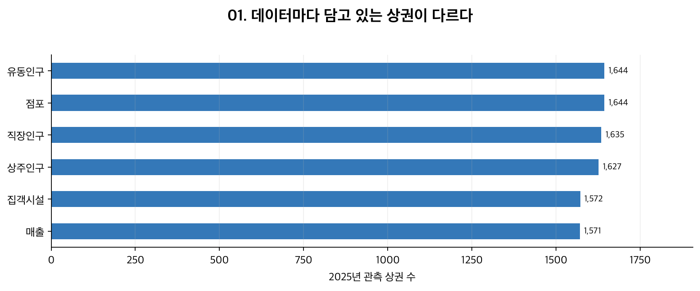

**그림 읽기:** 막대가 길수록 자료에 등장하는 상권이 많습니다.

**확인한 점:** 관광특구를 제외한 점포 상권은 1,644개, 매출 상권은 1,571개입니다.

**해석할 때 주의:** 행이 없다는 사실만으로 점포·인구·매출이 0이라고 판단하지 않습니다.


## 2. 작은 업종 칸의 매출은 보이지 않는다

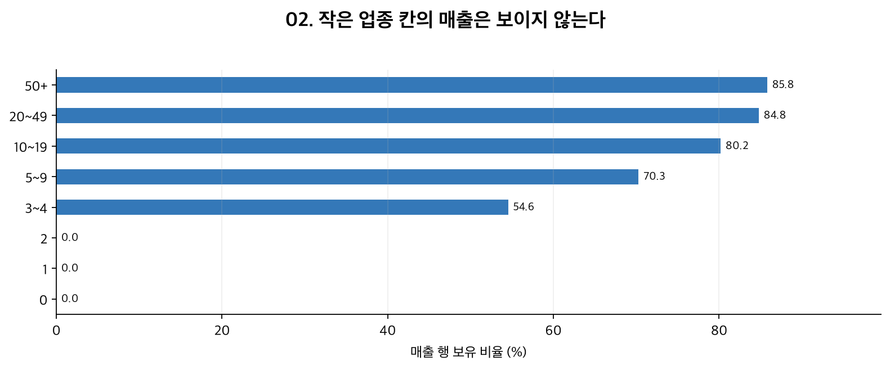

**그림 읽기:** 한 칸은 상권×업종×분기입니다. 점포 수별로 매출 자료가 있는 비율을 비교합니다.

**확인한 점:** 62개 매출 업종의 칸 중 매출 행이 없는 비율은 65.4%입니다. 매출이 연결된 칸의 최소 점포 수는 3개입니다.

**해석할 때 주의:** 관측된 패턴입니다. 미공개 사유를 공식 정책으로 단정하지 않습니다.


## 3. 업종에 따라 매출의 관측 범위가 다르다

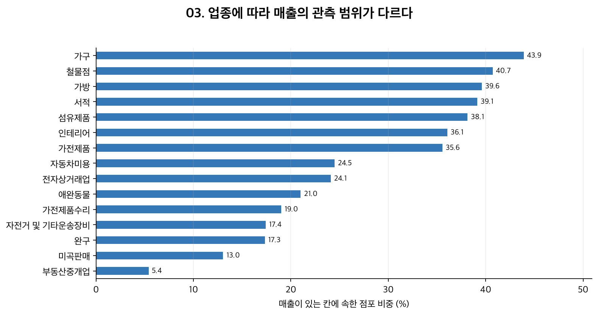

**그림 읽기:** 분기별 점포 수를 더한 뒤, 매출이 보이는 칸의 점포가 차지하는 비중을 구했습니다.

**확인한 점:** 매출 관측 범위가 50% 미만인 업종은 20개입니다. 가장 낮은 업종은 부동산중개업(5.4%)입니다.

**해석할 때 주의:** 각 점포의 매출을 직접 확보했다는 뜻은 아닙니다.


## 4. 관광특구 합산에 주의한다

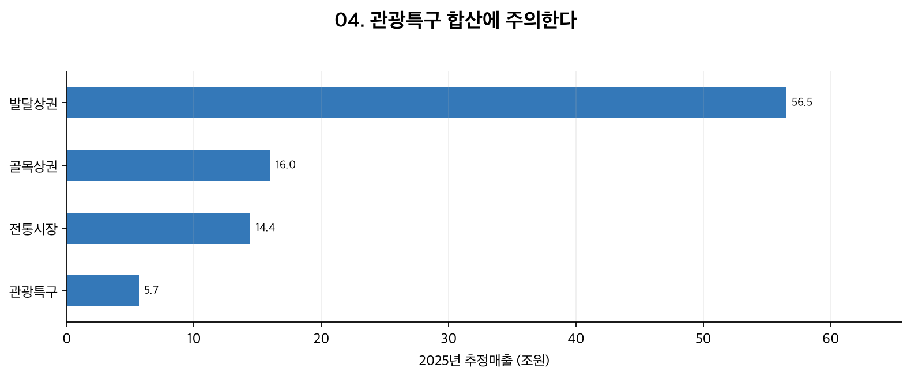

**그림 읽기:** 상권 종류별 매출을 비교합니다. 이 그림만 관광특구를 포함합니다.

**확인한 점:** 관광특구 포함 합계는 92.66조원, 제외하면 86.97조원입니다.

**해석할 때 주의:** 관광특구는 다른 상권과 공간이 겹칠 수 있어 이후 합계에서는 제외합니다. 나머지 합계도 서울 전체 업종의 실제 매출은 아닙니다.


## 5. 상권 종류별 점포 규모

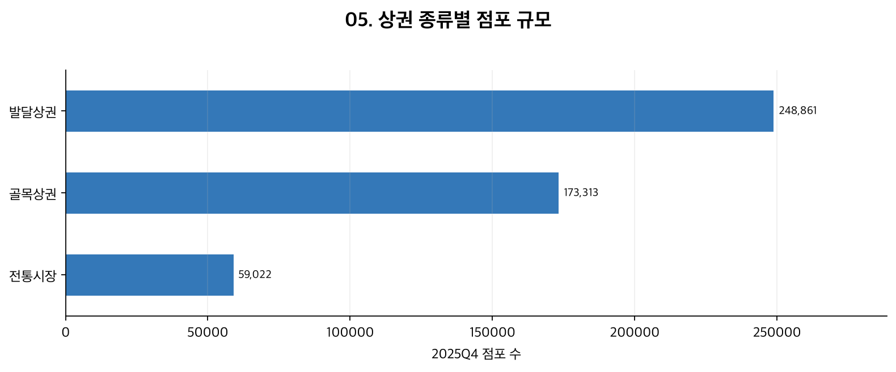

**그림 읽기:** 막대는 4분기 한 시점의 점포 수입니다.

**확인한 점:** 점포가 가장 많은 상권 유형은 발달상권입니다.

**해석할 때 주의:** 분기별 점포 수를 4개 분기 합산하면 점포가 중복 계산됩니다.


## 6. 점포가 많은 업종 20개

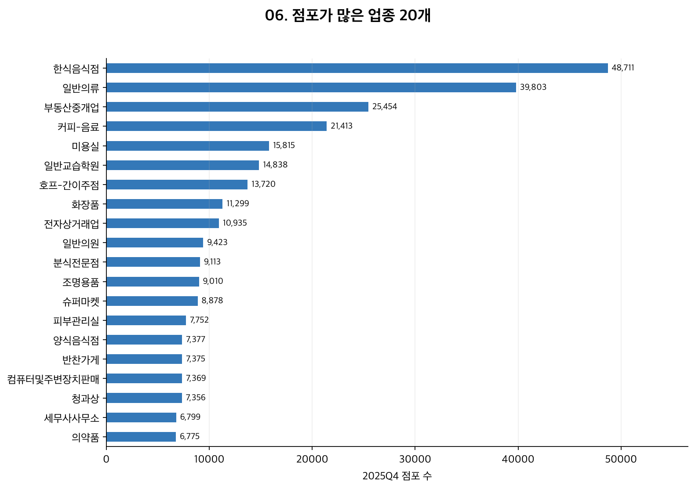

**그림 읽기:** 업종별로 현재 점포가 얼마나 많은지 비교합니다.

**확인한 점:** 4분기 점포 수 1위는 한식음식점입니다.

**해석할 때 주의:** 점포가 많다는 이유만으로 과잉 경쟁이라고 판단할 수 없습니다.


## 7. 매출 규모가 큰 업종 20개

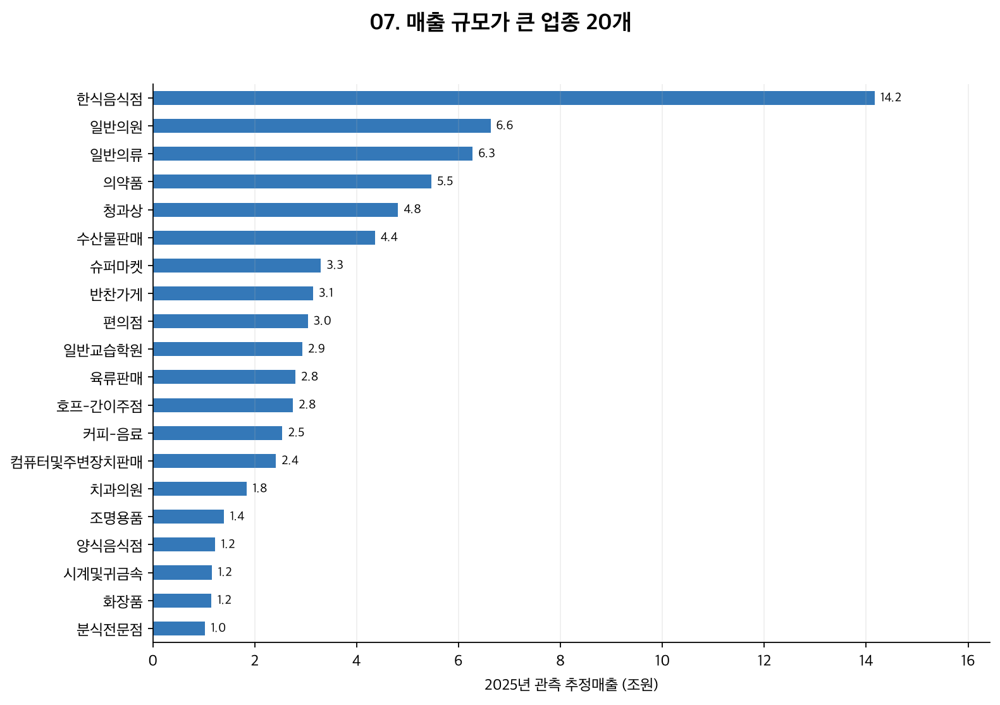

**그림 읽기:** 막대는 해당 업종의 관측 가능한 매출 합계입니다.

**확인한 점:** 관측 매출 합계 1위는 한식음식점입니다.

**해석할 때 주의:** 매출 자료가 없는 업종은 순위에서 제외했습니다. 이익과 창업 비용은 알 수 없습니다.


## 8. 점포당 매출로 업종을 다시 비교한다

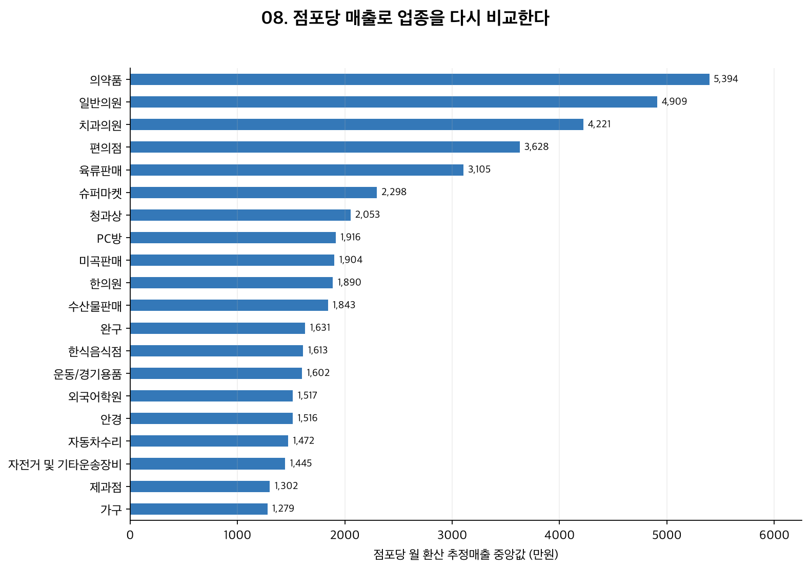

**그림 읽기:** 4개 분기 매출이 모두 있는 상권×업종에서 연매출÷평균점포 수÷12를 계산한 뒤 업종별 중앙값을 구했습니다.

**확인한 점:** 완전 관측 조합은 19,863개입니다. 중앙값은 값을 순서대로 세웠을 때 가운데 값입니다.

**해석할 때 주의:** 매출 추정 대상과 전체 점포 분모가 정확히 같다고 보장할 수 없어 근사 지표입니다. 개인 점포의 기대 매출이 아닙니다.


## 9. 매출은 일부 큰 값에 치우쳐 있다

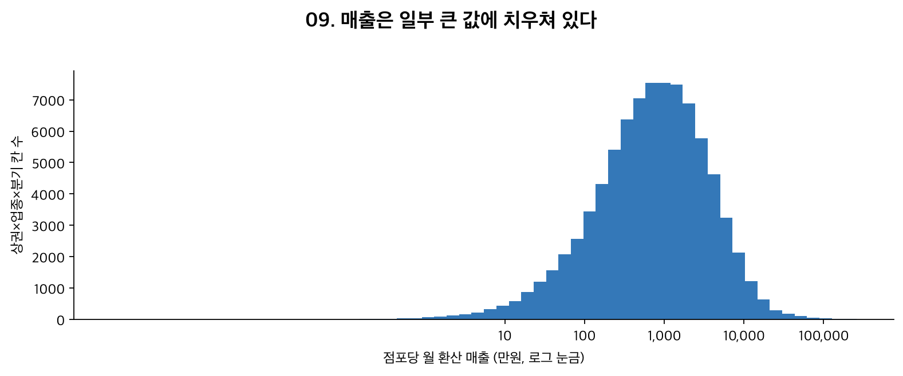

**그림 읽기:** 가로축은 10배씩 커집니다. 막대가 높을수록 그 매출 구간에 칸이 많습니다.

**확인한 점:** 관측 칸의 점포당 월 환산 매출 중앙값은 753만원, 평균은 2,060만원입니다.

**해석할 때 주의:** 큰 값을 삭제하지 않았습니다. 평균만 보면 일반적인 수준을 높게 느낄 수 있습니다.


## 10. 분기별 매출 흐름

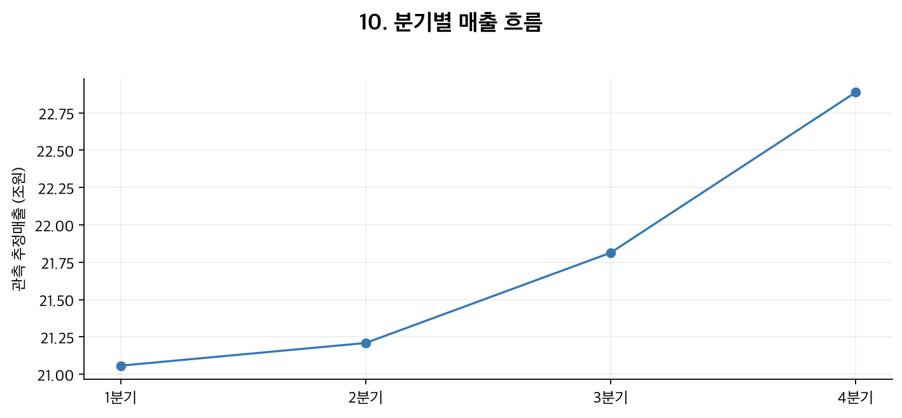

**그림 읽기:** 선이 올라가면 관측 매출 합계가 늘어난 것입니다.

**확인한 점:** 1분기 21.06조원에서 4분기 22.89조원으로 +8.7% 달라졌습니다.

**해석할 때 주의:** 전년 대비 성장률이 아닙니다. 계절과 분기별 관측 대상 변화가 섞입니다.


## 11. 같은 상권과 업종만 남겨 분기를 비교한다

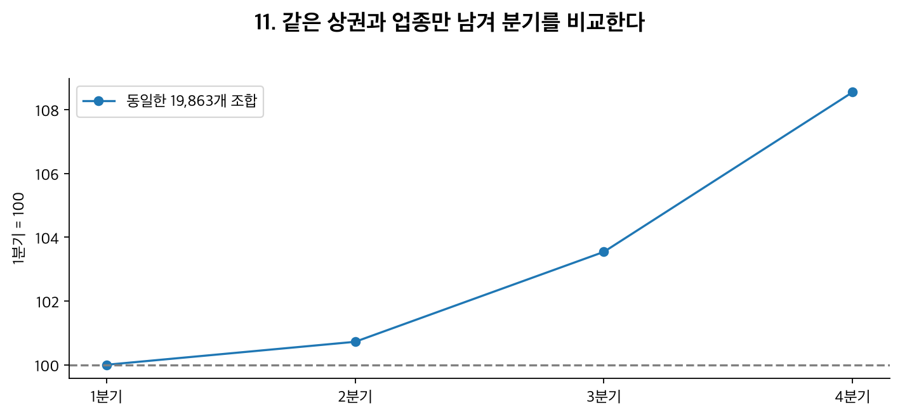

**그림 읽기:** 100보다 높으면 같은 조합의 매출이 1분기보다 높습니다.

**확인한 점:** 동일 조합의 4분기 지수는 108.5입니다.

**해석할 때 주의:** 네 분기 모두 보이는 조합만 남겨 작은 상권이나 새로 나타난 업종이 덜 반영됩니다.


## 12. 업종별 분기 흐름은 서로 다르다

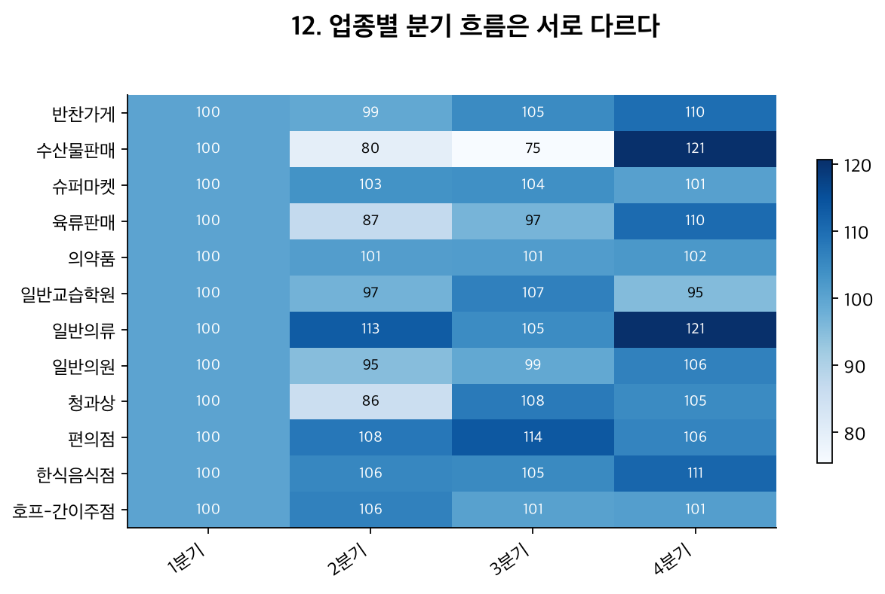

**그림 읽기:** 각 업종의 1분기를 100으로 맞췄습니다. 진할수록 해당 업종의 1분기보다 매출이 큽니다.

**확인한 점:** 관측 연매출 상위 12개 업종 중 4분기 지수가 가장 높은 업종은 수산물판매입니다.

**해석할 때 주의:** 이 그림은 업종별 관측 합계를 사용합니다. 장기 성장과 계절 효과를 분리할 수 없습니다.


## 13. 연매출 상위 상권 15개

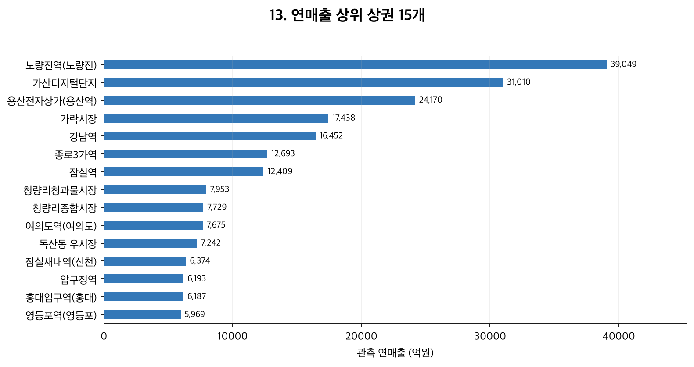

**그림 읽기:** 상권 전체 매출 합계를 비교합니다.

**확인한 점:** 관측 합계 1위는 노량진역(노량진)입니다.

**해석할 때 주의:** 큰 상권·고매출 업종이 유리한 순위입니다. 희망 업종에 좋은 입지 순위로 해석하지 않습니다.


## 14. 상위 상권이 특정 업종에 의존하는 정도

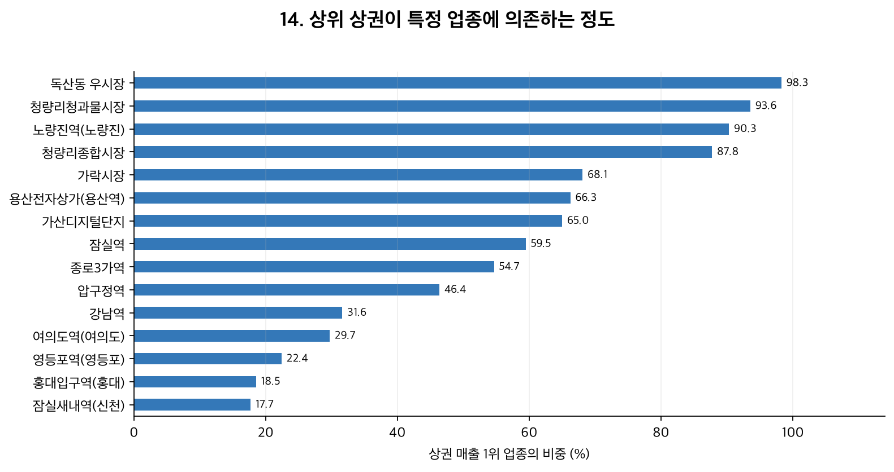

**그림 읽기:** 100%에 가까우면 한 업종이 매출 대부분을 차지합니다.

**확인한 점:** 연매출 상위 15개 상권 중 1위 업종 비중이 50%를 넘는 곳은 9곳입니다.

**해석할 때 주의:** 관측 업종 안에서 계산한 집중도입니다. 업종 다양성과 수익성을 같은 뜻으로 쓰지 않습니다.


## 15. 요일별 매출 비중

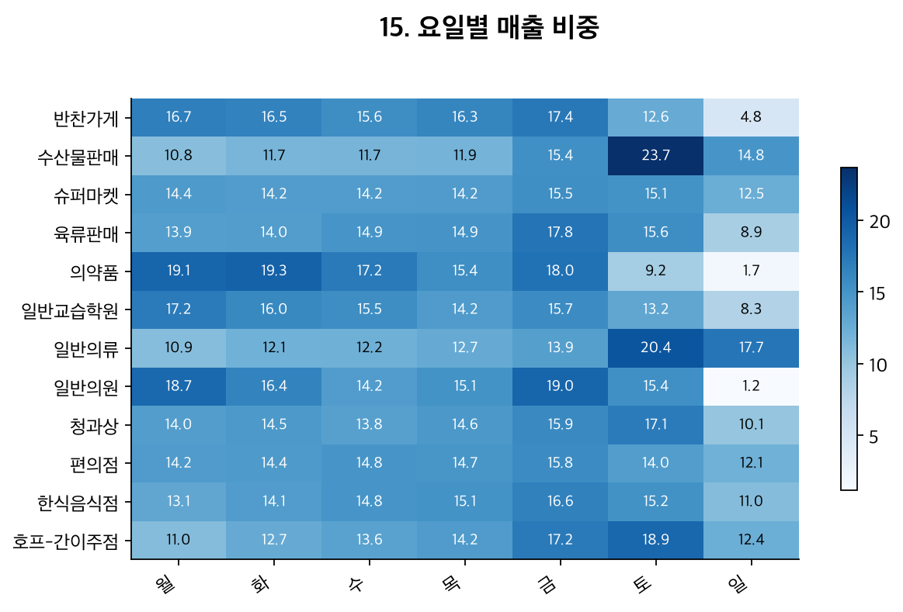

**그림 읽기:** 행은 업종, 열은 요일입니다. 각 행의 합이 100%이며, 숫자가 클수록 그 구간에서 매출 비중이 큽니다.

**확인한 점:** 관측 매출 상위 12개 업종 중 한식음식점은 금 비중이 16.6%로 가장 큽니다. 호프-간이주점은 토 비중이 18.9%로 가장 큽니다.

**해석할 때 주의:** 요일 수는 같지만 공휴일·분기 일수의 영향을 받습니다.


## 16. 시간대별 매출 비중

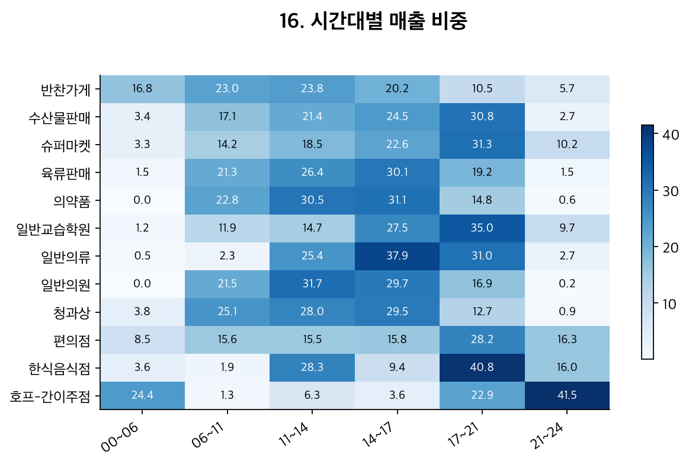

**그림 읽기:** 행은 업종, 열은 시간대입니다. 각 행의 합이 100%이며, 숫자가 클수록 그 구간에서 매출 비중이 큽니다.

**확인한 점:** 관측 매출 상위 12개 업종 중 한식음식점은 17~21 비중이 40.8%로 가장 큽니다. 호프-간이주점은 21~24 비중이 41.5%로 가장 큽니다.

**해석할 때 주의:** 시간대 길이가 서로 다릅니다. 비중이 크다고 시간당 매출도 높다고 단정할 수 없습니다.


## 17. 고객 연령별 매출 구성

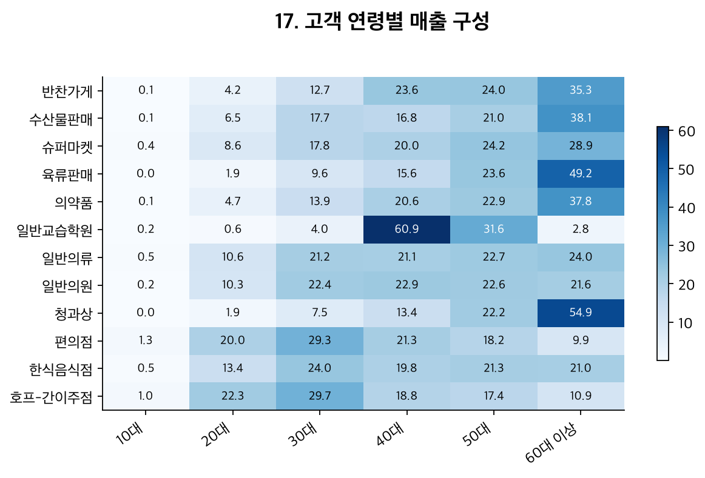

**그림 읽기:** 행은 업종, 열은 연령입니다. 각 행의 합이 100%이며, 숫자가 클수록 그 구간에서 매출 비중이 큽니다.

**확인한 점:** 관측 매출 상위 12개 업종 중 한식음식점은 30대 비중이 24.0%로 가장 큽니다. 호프-간이주점은 30대 비중이 29.7%로 가장 큽니다.

**해석할 때 주의:** 연령별 알려진 매출의 구성입니다. 방문객 수·지역 인구 구성과 다릅니다.


## 18. 주중과 주말을 하루 기준으로 비교한다

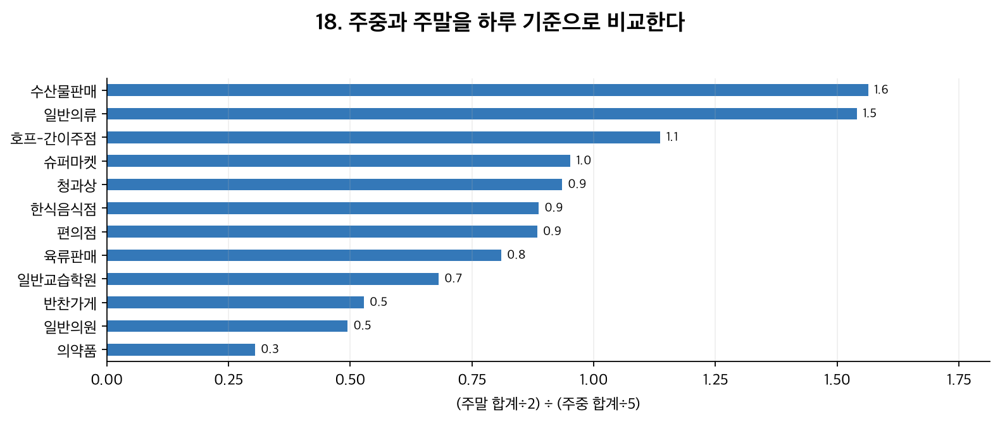

**그림 읽기:** 1보다 크면 주말 하루 평균 매출이 주중보다 큽니다. 요일 개수 차이를 단순 보정했습니다.

**확인한 점:** 상위 매출 업종 중 주말 쪽이 가장 강한 업종은 수산물판매입니다.

**해석할 때 주의:** 주중을 5일, 주말을 2일로 단순 환산했습니다. 실제 영업일수와 공휴일은 반영하지 않았습니다.


## 19. 프랜차이즈 비중이 높은 업종

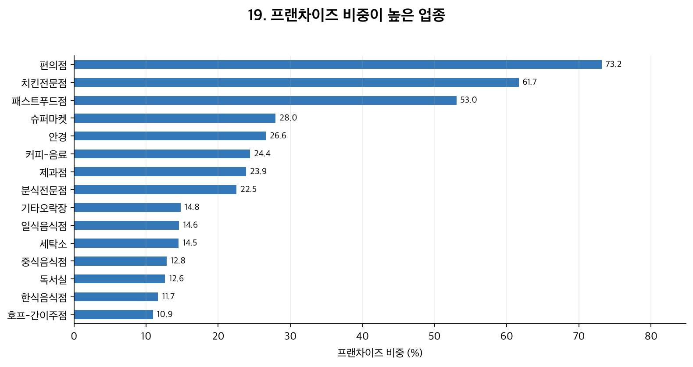

**그림 읽기:** 4분기 점포 100개 이상인 업종을 비교했습니다.

**확인한 점:** 이 기준에서 비중 1위는 편의점(73.2%)입니다.

**해석할 때 주의:** 가맹점이 많다는 사실만으로 신규 창업에 유리하거나 불리하다고 판단할 수 없습니다.


## 20. 분기별 개업과 폐업 건수

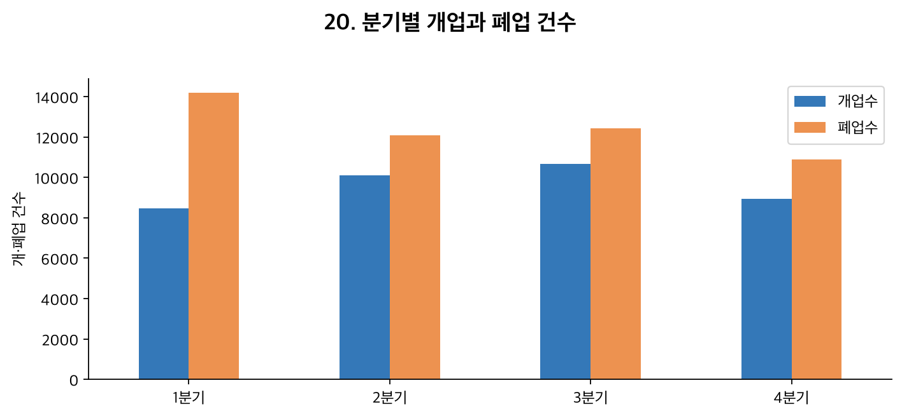

**그림 읽기:** 파란 막대는 개업, 주황 막대는 폐업입니다.

**확인한 점:** 연간 개업 38,194건, 폐업 49,596건입니다.

**해석할 때 주의:** 개업에서 폐업을 뺀 값이 점포 재고 증감과 항상 같지는 않습니다. 자료 정비와 분류 변화가 있을 수 있습니다.


## 21. 개업과 폐업이 잦은 업종

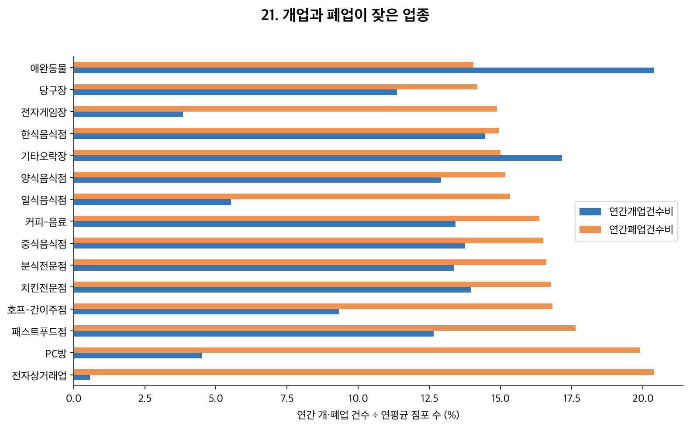

**그림 읽기:** 점포 규모 100개 이상 업종 중 폐업건수비 상위 15개입니다.

**확인한 점:** 해당 기준에서 가장 높은 업종은 전자상거래업(20.4%)입니다.

**해석할 때 주의:** 같은 점포를 1년간 추적한 폐업 확률이 아닙니다. 분기 폐업률을 단순 평균한 값도 아닙니다.


## 22. 점포가 적은 칸이 얼마나 많은가

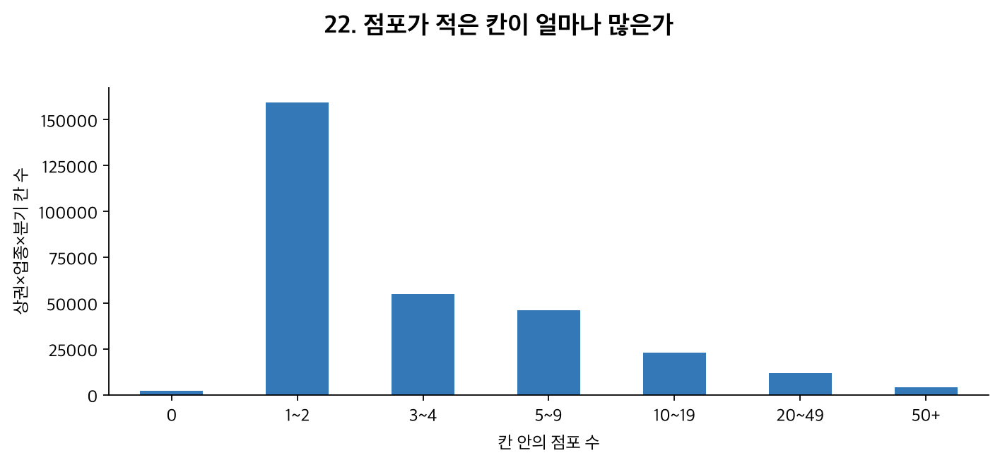

**그림 읽기:** 막대가 높으면 해당 규모의 칸이 많습니다.

**확인한 점:** 전체 점포 칸 중 점포 5개 미만인 비중은 71.6%입니다.

**해석할 때 주의:** 점포 2개인 칸에서 폐업 1건이면 단순 비율은 50%입니다. 작은 분모의 비율은 쉽게 흔들립니다.


## 23. 분기에 따라 매출이 크게 움직인 업종

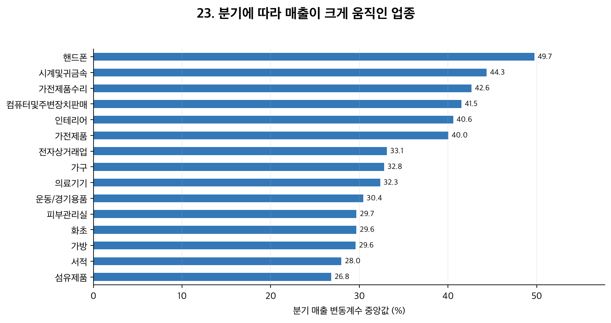

**그림 읽기:** 변동계수는 표준편차÷평균입니다. 네 분기 매출이 얼마나 들쑥날쑥한지 봅니다.

**확인한 점:** 완전 관측 조합이 30개 이상인 업종 중 가장 높은 업종은 핸드폰입니다.

**해석할 때 주의:** 4개 값으로 계산했습니다. 값이 크면 계절성이 강할 수 있으며, 곧바로 사업 실패 위험을 뜻하지 않습니다.


## 24. 인구와 시설 값이 실제로 바뀌었는지 점검한다

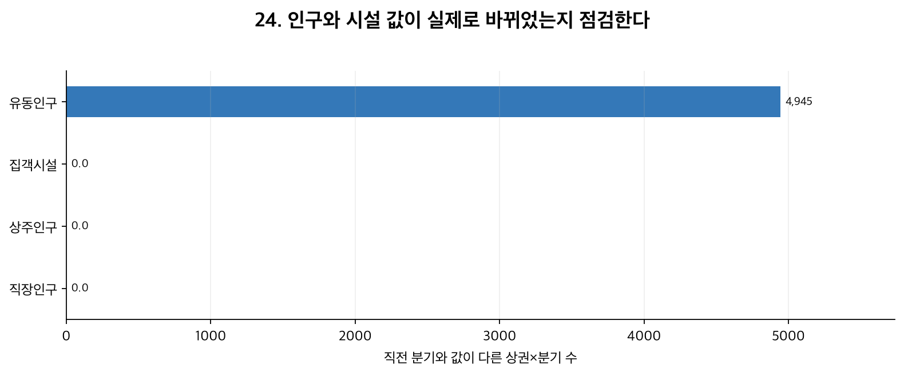

**그림 읽기:** 2025년 2·3·4분기를 각각 직전 분기와 비교했습니다. 모든 수치 컬럼 중 하나라도 달라진 상권을 셉니다.

**확인한 점:** 유동인구: 4,945건 / 직장인구: 0건 / 상주인구: 0건 / 집객시설: 0건

**해석할 때 주의:** 변경이 없다고 오류로 단정하지 않습니다. 파일의 기준분기와 실제 통계 작성시점이 다를 수 있습니다.


## 25. 상권 규모와 수요 지표의 관계

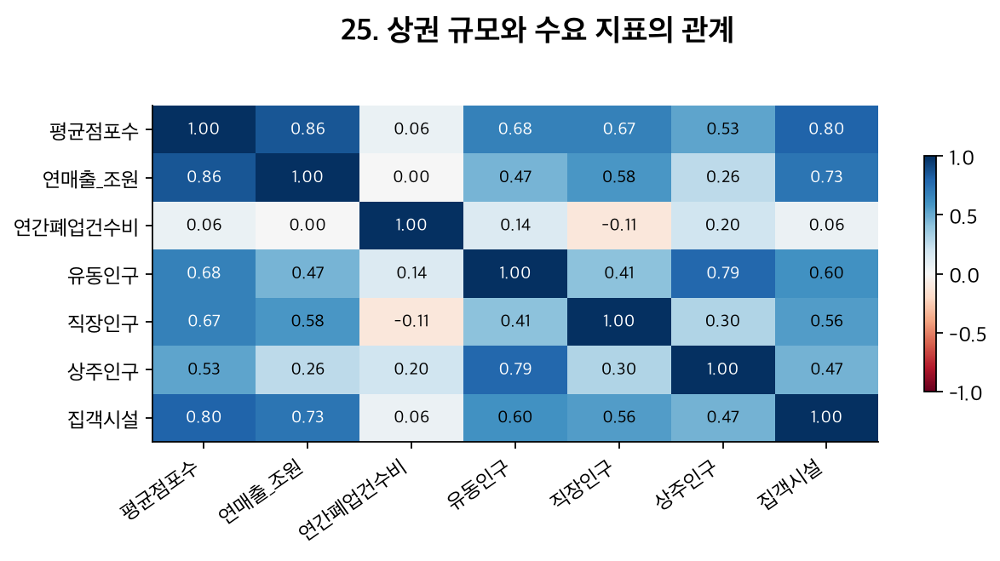

**그림 읽기:** 순위상관은 -1~1입니다. +1에 가까우면 함께 커지고, -1에 가까우면 반대 방향입니다.

**확인한 점:** 총매출과 유동인구의 순위상관은 0.47, 직장인구와는 0.58입니다.

**해석할 때 주의:** 상권 단위 관계이며 원인을 뜻하지 않습니다. 항목별로 값이 있는 상권만 사용합니다. 업종 구성·상권 면적을 보정하지 않았습니다.


## 26. 사람이 많은 상권의 매출을 점으로 확인한다

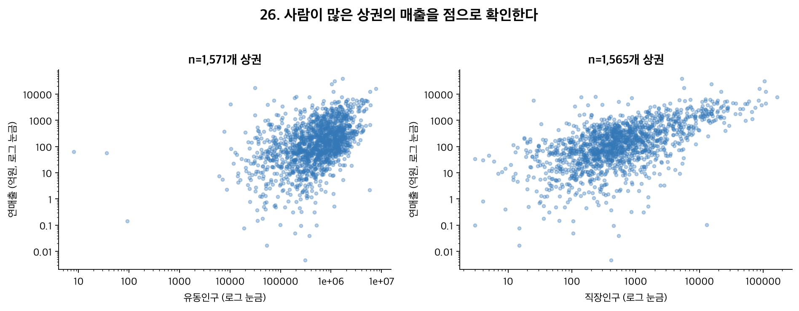

**그림 읽기:** 점 하나가 상권 하나입니다. 오른쪽은 인구가 많고 위쪽은 매출이 큽니다. 눈금 간격은 배수입니다.

**확인한 점:** 같은 인구 수준에서도 매출이 넓게 퍼져 있습니다. 수요 지표 하나만으로 매출을 설명하기 어렵습니다.

**해석할 때 주의:** 유동인구는 고유 방문자 수나 실제 구매자 수가 아닙니다. 0 또는 결측인 값은 로그 그림에서 제외했습니다.


## 27. 커피 업종에서 경쟁 점포와 매출을 함께 본다

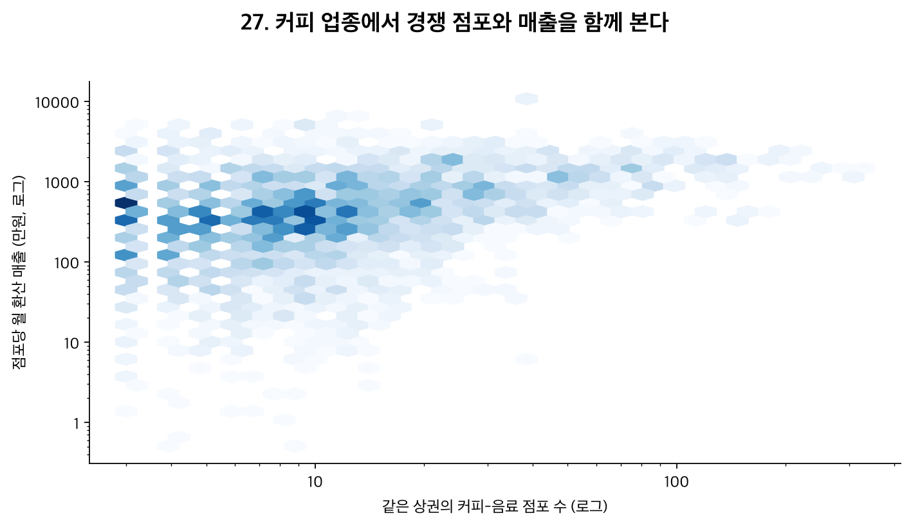

**그림 읽기:** 육각형 색이 진하면 비슷한 값의 칸이 많습니다. 오른쪽으로 갈수록 같은 업종 점포가 많습니다.

**확인한 점:** 커피-음료 관측 칸 4,272개에서 점포 수와 점포당 월 환산 매출의 순위상관은 0.37입니다.

**해석할 때 주의:** 분기가 반복된 탐색 그림입니다. 점포가 많아서 매출이 올랐는지, 매출이 높은 곳에 점포가 모였는지 알 수 없습니다.


## 28. 매출과 점포의 공간 분포

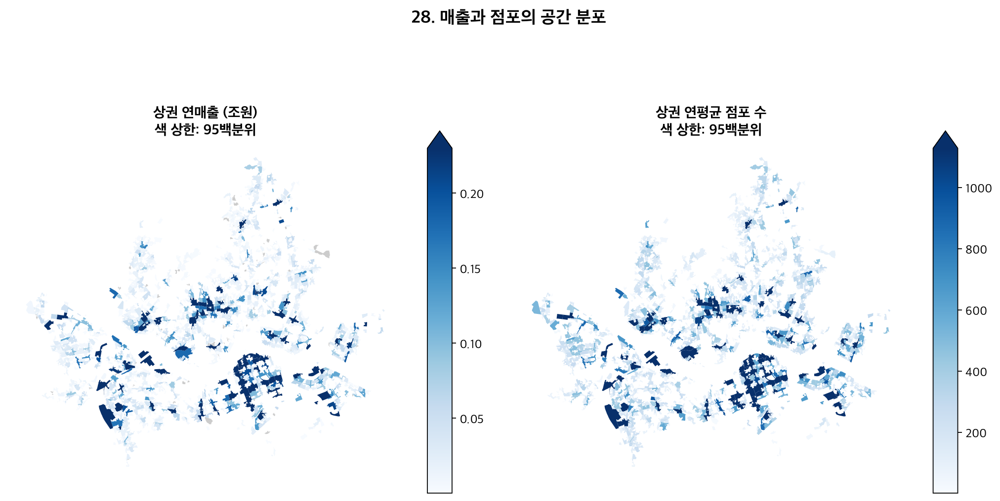

**그림 읽기:** 색이 진할수록 값이 큽니다. 회색은 연결된 값이 없고, 흰 배경은 상권 영역 밖입니다.

**확인한 점:** 상권 경계에 관측 값을 직접 붙여 점포와 매출이 모여 있는 위치를 비교했습니다.

**해석할 때 주의:** 큰 값 몇 개 때문에 다른 상권이 흐려지지 않도록 색의 상한을 95백분위로 맞췄습니다. 상한 이상은 같은 색입니다. 면적당 밀도 지도가 아닙니다.


## 29. 상가정보로 본 25개 자치구의 점포 분포

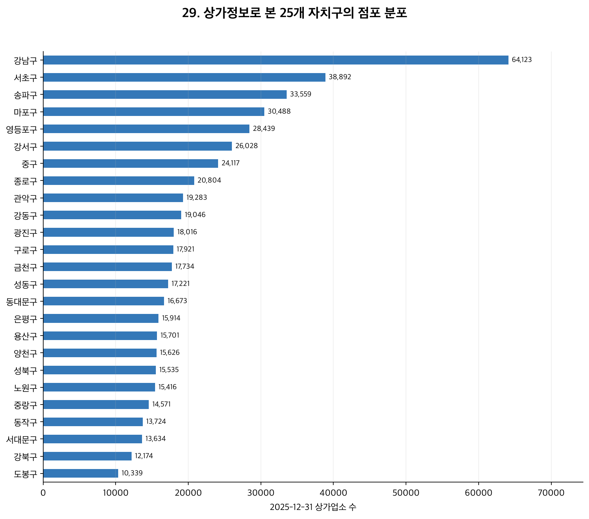

**그림 읽기:** 별도 출처인 소상공인 상가정보를 자치구별로 셌습니다.

**확인한 점:** 원본은 534,978행이고 상가업소번호 중복은 0건입니다. 점포가 가장 많은 곳은 강남구입니다.

**해석할 때 주의:** 서울 상권분석 데이터와 업종 범위·수집 기준이 다릅니다. 두 자료의 점포 수를 단순 합산하지 않습니다.


## 30. 상가정보의 대분류별 구성

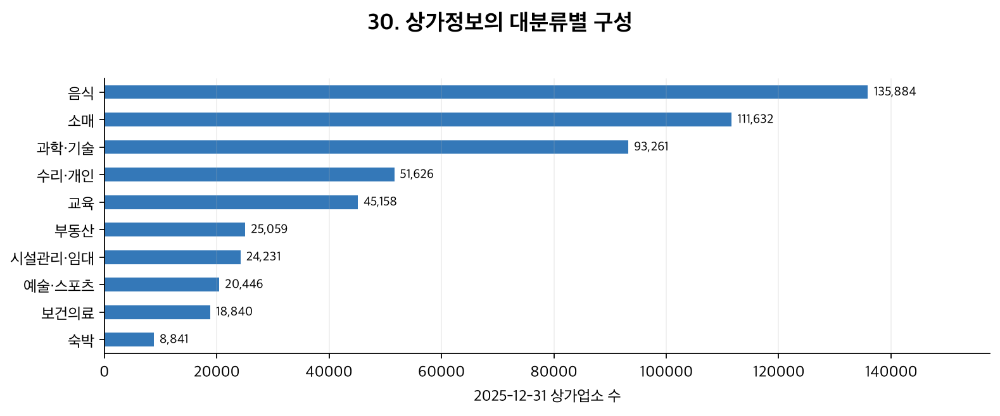

**그림 읽기:** 점포 수를 넓은 업종 묶음으로 나눴습니다.

**확인한 점:** 가장 큰 대분류는 음식입니다.

**해석할 때 주의:** 소상공인 업종코드와 서울 서비스업종코드는 서로 다릅니다. 이름이 비슷하다고 자동으로 결합하지 않습니다.


## 31. 시간대 길이를 보정하면 어떻게 보일까

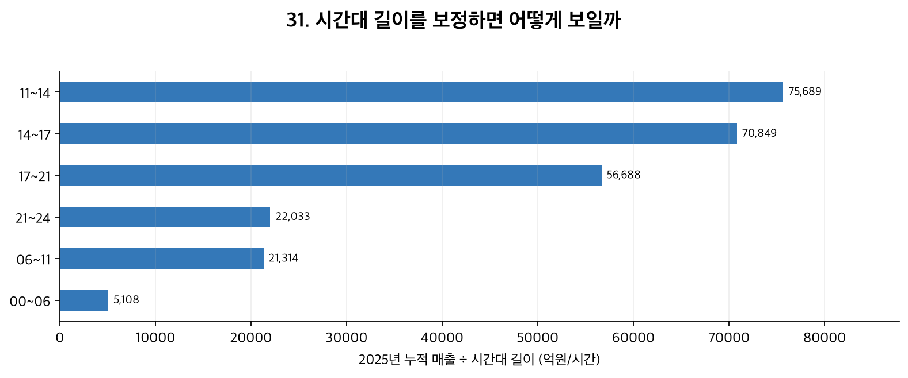

**그림 읽기:** 각 시간대 총매출을 그 시간대의 시간 수로 나눴습니다. 6시간 구간과 3시간 구간을 같은 길이로 비교하는 방법입니다.

**확인한 점:** 시간 길이를 보정한 값이 가장 큰 구간은 11~14입니다.

**해석할 때 주의:** 연간 누적액을 시간대 길이로만 나눈 값입니다. 실제 하루·영업일당 시간 매출은 아닙니다.

## 기존 EDA와 비교한 판단

매출 대상 업종에서 점포 0~2개인 칸의 비중과 매출 행이 없는 칸의 비중은 서로 다른 지표다. 이번의 65.4%는 후자이며, 관광특구를 제외한 기준이다. 점포가 3개 이상이어도 매출 행이 없는 칸이 있어 기존 문서의 48.8%(점포 0~2개 칸 비중)와 같은 수치로 비교하면 안 된다. 업종별 관측 범위도 관광특구 제외 여부에 따라 달라진다.

이번에 직접 다시 확인한 내용은 매출 관측 범위의 차이, 관광특구 제외 전후 합계 차이, 업종 하나에 치우친 상권 매출, 인구·시설의 반복 값, 작은 칸의 비율 불안정성이다. 기존 EDA의 방향과 대체로 일치한다.

기존 EDA의 공간 중복 97.1%, 회귀 탄력성, 신뢰구간, 축소 추정, 상·하반기 신뢰도는 이번 코드에서 재계산하지 않았다. 따라서 그 수치까지 독립 검증했다고 주장하지 않는다. 전자상거래업의 높은 폐업건수비만으로 데이터 오류를 단정하거나 추천 대상에서 즉시 제외하기보다는, 정의와 자료 변동을 먼저 확인하는 편이 좋다.

이번에는 요일·시간대·연령 구성, 주말 하루 환산 비교, 시간대 길이 보정, 프랜차이즈 비중, 업종별 분기 변동, 동일 조합 분기 비교를 추가했다. 상권별 매출 규모와 실제 창업 적합성을 구분해 읽도록 설명을 붙였다.

## Spotfit 추천 설계에 적용하기

| 분석에서 확인한 문제 | 다음 처리 제안 |
| --- | --- |
| 업종별 매출 수준이 크게 다름 | 희망 업종 안에서 상권을 비교한다 |
| 매출 행이 없는 작은 칸이 많음 | 미공개·미관측 상태를 표시하고 매출 점수를 억지로 만들지 않는다 |
| 점포 수는 수요와 함께 움직일 수 있음 | 점포 수만으로 경쟁 감점을 주지 않는다. 동일 업종 안에서 수요·점포당 매출을 함께 본다 |
| 개폐업 비율의 분모가 작음 | 건수와 점포 수를 함께 제시하고 더 넓은 지역·기간으로 묶어 확인한다 |
| 고객 소비 시간과 연령이 업종마다 다름 | 희망 업종의 영업 시간·고객층과 맞는 상권을 비교한다 |
| 1년으로 계절성과 성장을 분리하기 어려움 | 2024년 이전 자료를 추가해 같은 분기끼리 비교한다 |
| 시설·인구가 반복됨 | 실제 통계 시점을 확인하고 고정 속성으로 쓸지 결정한다 |
| 임대료·인건비·보증금·권리금이 없음 | 매출을 이익으로 해석하지 않고, 예산 적합성 확정에는 별도 비용 자료를 확보한다 |

금융 MBTI별 가중치나 상권 추천 점수는 이 EDA에서 만들지 않았다. 사용자 유형의 정의와 검증 자료가 있어야 실제 추천 규칙을 평가할 수 있다.

## 재현 방법과 근거 파일

프로젝트의 기존 가상환경에서 다음 명령으로 보고서·그림·근거 표를 다시 생성할 수 있다.

```bash
cd seoul-commercial-analysis
.venv/bin/python 김지영/codex_eda/run_eda.py
```

필요 패키지: pandas, numpy, matplotlib, geopandas 및 geopandas의 공간 파일 읽기 의존성. 현재 프로젝트 가상환경으로 실행했다. 한글 폰트는 시스템에 설치된 Apple SD Gothic Neo 등을 자동 선택한다.

- [재현 코드](codex_eda/run_eda.py)
- [원본 품질 점검](codex_eda/tables/quality.csv)
- [점포 규모별 매출 관측 범위](codex_eda/tables/coverage.csv)
- [업종별 관측 범위](codex_eda/tables/industry_coverage.csv)
- [업종별 요약](codex_eda/tables/industry.csv)
- [네 분기 완전 관측 조합](codex_eda/tables/complete_cells.csv)
- [상권별 요약](codex_eda/tables/districts.csv)
- [데이터 값 변경 점검](codex_eda/tables/refresh.csv)

그림을 다른 폴더로 옮길 때는 이 문서와 `codex_eda/figures/`의 상대 경로를 함께 유지해야 한다.
