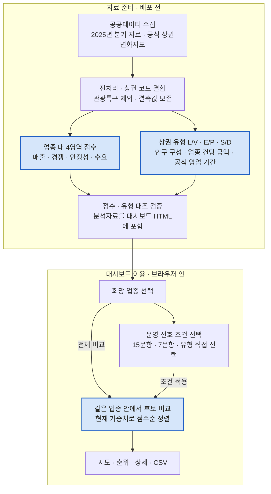
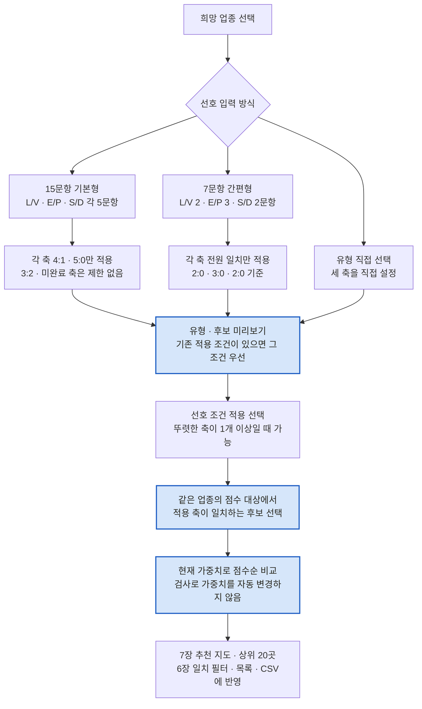

# Mermaid 흐름도 추가 · 2026-11-26

[공유 대시보드](https://spotfit-park-2025.park24401859.chatgpt.site/#s1) · [MBTI 화면](https://spotfit-park-2025.park24401859.chatgpt.site/#s7)

기존 크림색·파란색·각진 카드와 메뉴, 지도, 차트, 검사 화면을 유지했다. 1장의 ‘분석 과정 한눈에 보기’, 7장의 ‘MBTI 추천 과정 한눈에 보기’를 펼치면 볼 수 있다. 처음에는 접혀 있어 기존 화면 흐름을 유지한다. 휴대폰에서는 그림 영역만 좌우로 이동하며, 같은 내용을 글로도 제공한다. 화면 안에서 Mermaid 원본을 볼 수 있다.

Mermaid 12.3.0으로 생성한 SVG를 HTML 안에 직접 포함했다. 공개 대시보드와 더블클릭 실행 HTML은 Mermaid CDN이나 추가 설치 없이 두 그림을 표시한다. 렌더러를 쓰는 개발 단계에서만 인터넷 연결이 필요하다.

## 반영한 실제 동작

- 점수와 상권 유형은 전처리 자료에서 별도로 계산한다. 설문은 후보 필터이며 가중치를 자동으로 바꾸지 않는다.
- 15문항은 각 축 4:1·5:0, 7문항은 각 축 전원 일치(2:0·3:0·2:0)만 후보 조건으로 쓴다. 자료가 없는 적용 축은 일치 후보에 넣지 않는다.
- 공통 조건을 적용하기 전의 미리보기와 적용 후 상태를 구분한다. 기존 적용 조건이 있으면 그 조건이 우선하고, 새 탭 선택만으로 적용 조건은 바뀌지 않는다.
- 7장은 서울 전체 후보 상위 20곳, 6장은 일치 필터·선택 자치구·CSV를 연결한다. 추천 후보가 없다고 다른 유형을 자동 대체하지 않는다.

기존 `web/core.js`, `web/app.js`와 HTML 내 분석 JSON은 변경하지 않았다. 기존 HTML은 두 설명 블록을 빼면 같고, 기존 CSS는 그대로 둔 뒤 새 영역에만 스타일을 추가했다. 검증 기록: `report/validation_diagrams.json`, `report/browser_check_diagrams.json`.

## 원본과 재생성

`diagrams/analysis.mmd`, `diagrams/mbti.mmd`가 원본이고 같은 이름의 `.svg`가 생성물이다. `mermaid-config.json`은 기존 화면에 맞춘 렌더 설정이다.

1. 이 폴더에서 `python diagrams/preview_server.py`를 실행한다.
2. `http://127.0.0.1:8767/diagrams/render.html`을 브라우저로 열고 ‘두 SVG 저장됨’을 확인한다. 로컬 서버는 지정한 두 SVG만 저장한다.
3. `python diagram_upgrade.py` 후, 프로젝트의 고정 Python 환경에서 `python build.py --assemble-only`를 실행한다. `adapt_sources.py`를 다시 실행해도 두 흐름도가 함께 복원된다.
4. 미리보기를 마치면 서버를 종료한다.

새 설명 블록은 기존 차트의 전역 `svg text` 글자 크기(11px)를 상속하지 않도록 이 영역에서만 16px로 고정한다. 밝은/어두운 테마의 기존 색상 변수를 함께 쓴다.

## 전체 분석 흐름도

## MBTI 추천 흐름도

