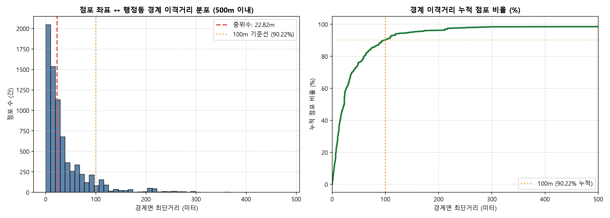
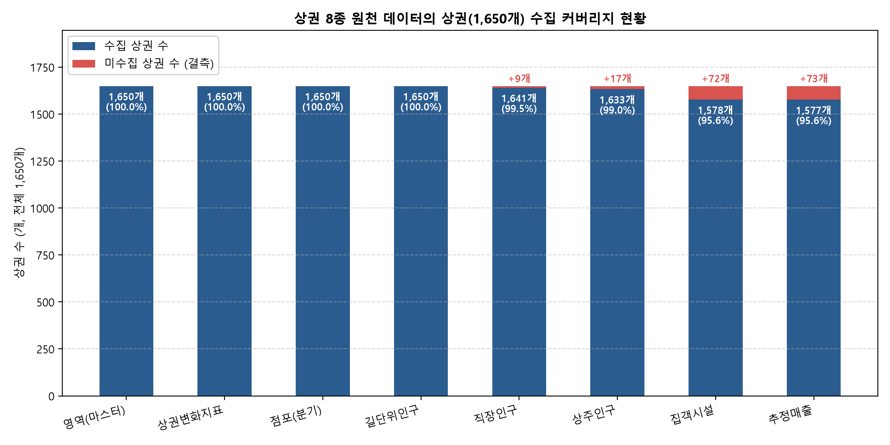
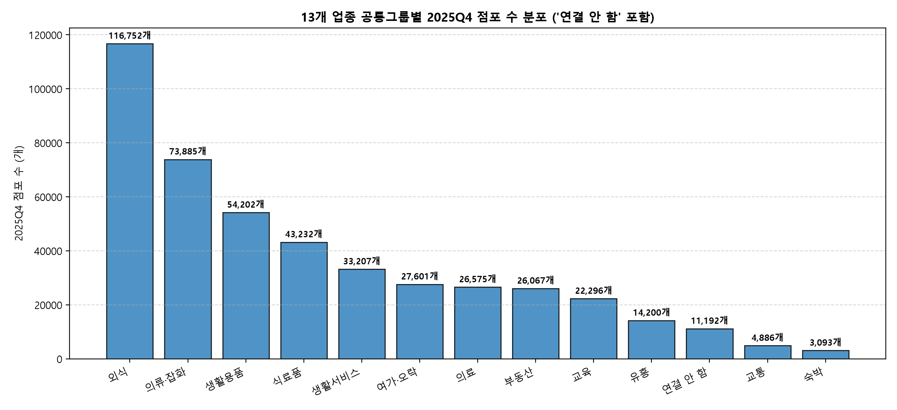

# 02. 서울시 상권 데이터 전처리 및 결합 설계 보고서 (2025Q4)

> **작성 목적**: 예비 창업자 맞춤형 상권 추천 서비스의 데이터 결합 단계로서, 상권·업종·행정동 단위 이종 데이터를 체계적으로 연계하고 4대 계층 마트 구조 및 정합성 검증 결과를 보고합니다.
> 
> **기준 원칙 및 사용자 승인 결과**:
> - 점포 위치 기준: 소상공인 원천 행정동코드(2.4절 분동·통합 적용) 기준 집계 승인 (점포 총계 534,978건 일관성 유지)
> - 양재역 상권 자치구: 원천 `OA-15560` 기재대로 **서초구(11650)** 유지 (대안 선택 반영)
> - 대용량 마트: Parquet 및 CSV 병행 저장 승인 (`상권_업종_분기_마트` 246,197행)
> - 분석 단위: 파생변수 3단계 이관 및 4대 계층 마트 구조 적용

---

## 1. 사전 조사 및 데이터 정합성 검증 결과

### 1.1 점포 위치 불일치 원인 상세 분석 (7,722건 전체 대조)
소상공인 상가정보 원천 데이터(534,978건)의 경도·위도 좌표와 2025-12 행정동 경계 GeoJSON(`HangJeongDong_ver20251231.geojson`)을 공간 조인(Point-in-Polygon)하여 코드로 전체 대조하였습니다.

| 구분 항목 | 점포 건수 (건) | 비율 (%) | 분모 | 데이터 확인 내용 및 원인 분석 |
|:---|---:|---:|:---|:---|
| 서울 경계 내부 점포 | 534,898 | 99.985% | 전체 점포(534,978건) | 서울시 427개 경계 폴리곤 내부 위치 확인 |
| 서울 경계 외부 점포 | 80 | 0.015% | 전체 점포(534,978건) | 서울 경계 외부 (7개 구 80건) |
| 원천 코드 불일치 건수 | 7,722 | 1.444% | 서울 내부 점포(534,898건) | 1단계 검수 수치와 일치 |
| └ 분동·통합 해소 건수 | 52 | 0.01% | 서울 내부 점포(534,898건) | 용신동(용두동 30건, 신설동 22건) 코드 차이 해소 |
| └ 잔여 불일치 점포 | 7,670 | 1.434% | 서울 내부 점포(534,898건) | 2.4절 적용 후에도 좌표 경계와 코드가 다른 점포 |
| - 동일 자치구 내 인접동 | 7,302 | 95.2% | 잔여 불일치(7,670건) | 같은 구 내 인접 행정동 경계 불일치 |
| - 자치구 초과 불일치 | 368 | 4.8% | 잔여 불일치(7,670건) | 인접 자치구 경계로 넘어간 점포 |

- **경계 이격거리 분석**: 잔여 불일치 점포 7,670건의 점포 좌표에서 기재 행정동 경계선까지의 최단거리를 미터 단위로 계산한 결과, **중위수는 22.82m, 평균은 51.01m**입니다.
  - **10m 이내**: 2,090건 (27.25%)
  - **50m 이내**: 5,833건 (76.05%)
  - **100m 이내**: 6,920건 (90.22%)
  - **500m 이내**: 7,556건 (98.51%)
  - **500m 초과**: 114건 (1.49%)

- **서울 경계 밖 80건 자치구별 분포 (원천 시군구명 기준)**:
  - 금천구: 31건
  - 노원구: 24건
  - 강동구: 15건
  - 서초구: 5건
  - 구로구: 3건
  - 은평구: 1건
  - 중랑구: 1건

- **원인 구분 보고**:
  - [데이터 확인]: 52건은 2025년 행정동 분동(용신동)에 따른 코드 체계 차이이며, 잔여 불일치의 90.22%는 경계면 100m 이내의 최근접 위치입니다.
  - [가설] 인접 지자체 경계선 접경 지역의 GPS 오차 또는 행정동 경계 폴리곤의 미세한 간극으로 인한 분류일 가능성이 높습니다.
  - [가설] 도로 중심선이나 대지 필지 분할선에 건물이 위치하여 출입구 지오코딩 좌표가 인접 행정동으로 분류되었을 가능성이 높습니다.
  - [가설] 500m를 초과하는 114건은 지오코딩 변환 실패 또는 사업자등록 주소 오기입으로 추정됩니다.

*근거 파일: `data/processed/stage2/점포_위치_불일치_통계.json`, `data/processed/stage2/점포_위치_불일치_목록.csv`*

### 1.2 공용 표 4종 원천 대조 및 행 수 차이 원인 분석
기존 `data/processed/` 공용 표 4종을 원천 데이터와 대조하고 재현성을 시험하였습니다.

| 공용 표 파일명 | 행 수 × 열 수 | 기본 기준 키 | 원천 대조 검증 항목 | 원천 값 | 공용 표 값 | 일치 여부 |
|:---|---:|:---|:---|---:|---:|:---:|
| `업종_공통그룹.csv` | 72행 × 4열 | `원본출처+원본코드` | 매핑 업종 수 (상권 62개 + 소비 10개) | 72개 | 72개 | 일치 |
| `행정동_마스터.csv` | 425행 × 57열 | `행정동_코드` | 서울시 행정동 수 / 소상공인 점포수 | 425개 / 534,978개 | 425개 / 534,978개 | 일치 (차이 0) |
| `행정동_분기.csv` | 1,700행 × 39열 | `행정동_코드+기준_년분기_코드` | 연간 상권 추정매출 합계 / 점포수 합 | 92.66조원 / 1,842,421개 | 92.66조원 / 1,842,421개 | 일치 (차이 0) |
| `상권_업종_분기.csv` | 246,197행 × 15열 | `분기+상권+업종코드` | 연간 상권 추정매출 합계 / 점포수 합 | 92.66조원 / 1,842,421개 | 92.66조원 / 1,842,421개 | 일치 (차이 0) |

- **공용 표 4종 격리 재현 시험 결과 (`scripts/build_processed_2025.py` 실행)**:
  - 독립된 임시 폴더에서 `build_processed_2025.py`를 실행하여 4개 표를 처음부터 다시 생성하고 기존 `data/processed/` 파일과 데이터프레임 셀 값 단위(pandas equals)로 비교 검증하였습니다.
  - `업종_공통그룹.csv`: 72행 × 4열 (일치: True, 차이: 0행)
  - `행정동_마스터.csv`: 425행 × 57열 (일치: True, 차이: 0행)
  - `행정동_분기.csv`: 1,700행 × 39열 (일치: True, 차이: 0행)
  - `상권_업종_분기.csv`: 246,197행 × 15열 (일치: True, 차이: 0행)
  - 시험 결과: 4개 공용 표 모두 원천 데이터로부터 오차 없이 100.0% 동일하게 재현됨을 확인하였습니다.
  *(근거 파일: `data/processed/stage2/공용표_재현시험_결과.json`)*

- **원천 62개 업종 점포 행 수와 마트 행 수 차이 분석 (코드로 직접 계산)**:
  - 원천 점포 62개 업종 행 수는 **246,258행**입니다.
  - `scripts/build_processed_2025.py`에서 점포 수=0, 개업 수=0, 폐업 수=0이면서 추정매출도 비어 있는(NaN) 무실적 행 **61행**을 제외하였습니다.
  - 계산 결과: 246,258행 - 61행 = **246,197행**으로 마트 행 수와 정확히 일치합니다.
  - 추정매출이 비어 있는(NaN) 총 160,465행의 구성:
    1) 점포 수가 1개 이상 존재하지만 추정매출 행이 없는 경우: **158,895행**
    2) 점포 수는 0개이지만 개업 또는 폐업 실적이 있어 보존된 경우: **1,570행**

### 1.3 상권 중심점 ↔ 대표 행정동 불일치 조사
상권 중심점 좌표(좌표계: `EPSG:5181 (GRS80 중부원점 TM)`를 `EPSG:4326 (WGS84)`로 변환)와 2025-12 행정동 경계 GeoJSON을 대조한 결과입니다.
- **행정동 불일치 상권 수**: 전체 1,650개 중 **31개 (1.88%)**의 중심점이 대표 행정동 경계 외곽(인접 행정동)에 위치합니다.
- **자치구 불일치 상권 수**: 31개 중 자치구 경계까지 넘어간 상권은 **3개**입니다.
  - 상권코드 `3110531` (홍지문): 원천=종로구(부암동) ↔ 중심점 좌표=서대문구(서울특별시 서대문구 홍은1동)
  - 상권코드 `3110591` (충정로역 6번): 원천=중구(중림동) ↔ 중심점 좌표=마포구(서울특별시 마포구 공덕동)
  - 상권코드 `3120178` (신사역): 원천=서초구(잠원동) ↔ 중심점 좌표=강남구(서울특별시 강남구 논현1동)

- **양재역 상권 코드 충돌 검증 (사용자 대안 선택 반영)**:
  - 상권 코드: **3120179** (양재역) | 구분: 발달상권
  - 원천 기재 자치구: **서초구 (11650)** [사용자 대안 선택 반영]
  - 대표 행정동: **도곡1동 (11680655)** (강남구 관할)
  - [가설] 충돌 원인: 강남대로를 경계로 서초구와 강남구가 맞닿아 있는 대형 환승 역세권 상권 특성상, 서울시 공공데이터가 자치구는 서초구로, 대표 행정동은 강남구 도곡1동으로 서로 엇갈려 부여한 원천 데이터 고유의 불일치입니다.

*근거 파일: `data/processed/stage2/상권_중심점_행정동_불일치_목록.csv`*

### 1.4 집객시설 총합과 세부 합의 실제 관계 및 결측 처리
`OA-15580_집객시설_상권.csv`의 전체 6,312행 및 1,578개 상권을 코드로 직접 집계한 결과입니다.
- **행 기준 (총 6,312행 집계)**:
  - `집객시설_수 > 세부_합`: **5,952행 (94.30%)**
  - `집객시설_수 == 세부_합`: **360행 (5.70%)**
  - `집객시설_수 < 세부_합`: **0행 (0.00%)**
- **상권 기준 (원천 수집 1,578개 상권, 4개 분기 동일)**:
  - `집객시설_수 > 세부_합`: **1,488개 상권 (94.30%)**
  - `집객시설_수 == 세부_합`: **90개 상권 (5.70%)**
  - `집객시설_수 < 세부_합`: **0개 상권 (0.00%)**
- **전체 1,650개 상권 대비 집계 상태**:
  - 원천 행 없음 (`집객시설_원천행_없음 = True`, `NaN` 보존): **72개 상권 (4.36%)**
  - `집객시설_수 > 세부_합`: **1,488개 상권 (90.18%)**
  - `집객시설_수 == 세부_합`: **90개 상권 (5.45%)**
- **결측 처리 기준 확정**: 원천에 행이 없는 **72개 상권**은 0으로 채우지 않고 `NaN`으로 보존하며, `집객시설_원천행_없음 = True` 이름표를 부여하였습니다. 행이 존재하는 상권 내부의 결측 칸만 규칙대로 0으로 채웠습니다.

## 2. 승인된 9대 핵심 분석 항목-파일 연결표

| 핵심 항목 | 대응 원천 파일 | 분석 단위 | 기준 시점 | 주요 수록 컬럼 | 계산 및 집계 방법 | 데이터 한계 및 주의사항 |
|:---|:---|:---:|:---:|:---|:---|:---|
| **고객 구성** | `OA-15568`(유동) `OA-15584`(상주) `OA-15569`(직장) | 상권×분기 상권 고정 | 2025Q1~Q4 고정 스냅샷 | 유동·상주·직장 인구수 (성·연령·시간대) | - 유동: 분기별 합계 - 상주·직장: 고정 마스터 분리 (분모: 해당 총인구) | [가설] 상주·직장은 인구 센서스 기반으로 계절 변동 파악 불가. 유동인구 5개 슬롯 미집계 칸 존재 |
| **객단가** | `OA-15572_추정매출_상권` | 상권×업종×분기 | 2025Q1~Q4 | `당월_매출_금액`, `당월_매출_건수` | `당월_매출_금액 ÷ 당월_매출_건수` (원/건) | 3단계 상권 특성표에서 계산. 62개 업종별 단가 편차가 커 상권 전체 단순평균 금지 |
| **프랜차이즈 비율** | `OA-15577_점포_상권` | 상권×업종×분기 | 2025Q1~Q4 | `프랜차이즈_점포_수`, `전체_점포_수` | `프랜차이즈_점포_수 합 ÷ 전체_점포_수 합 × 100` (%) | 3단계 상권 특성표에서 계산. 행별 비율 평균 왜곡 방지를 위해 반드시 점포 수 합계로 재계산 |
| **매출 변화** | `OA-15572_추정매출_상권` | 상권×업종×분기 | 2025Q1~Q4 | `당월_매출_금액`, `기준_년분기_코드` | 분기별 매출 증감률 `(Q_t - Q_{t-1}) ÷ Q_{t-1} × 100` (%) | 2025년 4개 분기 자료로 1분기 전분기 대비 증감률 결측 발생, 연간 계절성 분리 한계 |
| **경쟁 (밀집도)** | `OA-15577_점포_상권` `OA-15560_영역_상권` | 상권×업종×분기 상권 고정 | 2025Q1~Q4 | `전체_점포_수`, `영역_면적` | 상권 내 업종별 점포 수, `점포_수 ÷ (영역_면적 / 10,000)` (개/ha) | 상권 경계 외부 인접 점포 미포함 |
| **개폐업** | `OA-15577_점포_상권` | 상권×업종×분기 | 2025Q1~Q4 | `개업_점포_수`, `폐업_점포_수`, `전체_점포_수` | `개업(폐업)_점포_수 합 ÷ 전체_점포_수 합 × 100` (%) | 3단계 상권 특성표에서 계산. 점포 1~2개 상권의 비율 왜곡 방지 위해 합계로 재계산 |
| **상권 변화 지표** | `OA-15576_상권변화지표_상권` | 상권×분기 | 2025Q1~Q4 | `상권_변화_지표_명`, `운영_영업_개월_평균`, `폐업_영업_개월_평균` | 원천 지표 코드 및 평균 개월 수 보존 | 정체·상권축소·다이나믹·상권확장 4대 범주 및 평균치만 제공 |
| **소비 수준** | `OA-22166_소비_행정동` `행정동_마스터` | 행정동×분기 | 2025Q1~Q4 | `지출_총금액`, 10대 항목 지출액, `소비_이상치` | 상권의 대표 `행정동_코드`를 키로 연결 | 상권 자체 소비가 아닌 배후 행정동 소비. 이상치 8곳 플래그 병기 |
| **집객시설** | `OA-15580_집객시설_상권` | 상권 고정 | 2025년 고정 | `집객시설_수`, 19개 세부 시설 수 | 원천 행 없는 상권 NaN 보존, 행 내 빈칸은 0으로 채움 | 4개 분기 수치 동일. 총 집객시설 수는 94.30%에서 세부 합보다 큼 |
| **임대료·보증금** | 데이터 없음 | 상권 단위 | 데이터 없음 | 데이터 없음 | **'데이터 없음'** 표기 | 원천 데이터 미수집 항목으로 임의 추정 금지 |

*근거 파일: `data/processed/stage2/항목_파일_연결표.csv`, `data/processed/stage2/데이터사전.csv`*

## 3. 분석 단위 및 4대 계층 마트 구조

분석 단위가 다른 데이터를 1개 테이블에 무리하게 결합하지 않고, 파생변수를 3단계로 이관하여 4대 계층 마트 구조로 구축하였습니다.

| 계층 구분 | 테이블 명칭 | 파일 형식 | 행 수 × 열 수 | 기본 기준 키 | 핵심 분석 지표 및 수록 내용 |
|:---|:---|:---:|---:|:---|:---|
| **계층 1** | `상권_업종_분기_마트` | Parquet / CSV | 246,197행 × 17열 | `분기+상권코드+업종코드` | 62개 업종별 매출·건수, 점포수, 일반/프랜차이즈, 개폐업 점포수 |
| **계층 2** | `상권_분기_마트` | CSV | 6,600행 × 45열 | `분기+상권코드` | 1,650개 상권별 유동인구, 상권변화지표, 상권 총매출·점포 합계 |
| **계층 3** | `상권_마스터` | CSV | 1,650행 × 86열 | `상권_코드` | 영역 면적, 중심점 좌표, 상주인구, 직장인구, 집객시설, 이름표 |
| **계층 4** | `행정동_마스터/분기` | CSV | 425행 / 1,700행 | `행정동_코드 (+분기)` | 배후 행정동 소비수준(53조원), 소득월액, 소상공인 10대 점포수 |

- **점포 수 기준 안내**: 점포 수는 특정 시점의 활동 점포 수이므로 4개 분기를 단순 합산한 **1,842,421개**는 '분기별 합산' 수치입니다. 실제 시점 분석에는 **2025Q4 점포 수인 457,188개**(20251: 464,115개, 20252: 461,638개, 20253: 459,480개, 20254: 457,188개)를 기준으로 사용합니다.

## 4. 조인별 전후 비교 및 일치성 검증

각 결합 단계마다 `validate` 매개변수를 지정하여 1:1 및 m:1 키 일치 관계를 확인하였습니다.

| 단계 | 대상 마트 | 결합 내용 | 조인 키 | 방식 | validate | 조인 전 행수 | 조인 후 행수 | 키 고유수 | 조인 전 매출합계 | 조인 후 매출합계 | 조인 전 점포합계 | 조인 후 점포합계 | 결측 건수 | 처리 및 검증 사유 |
|:---:|:---|:---|:---:|:---:|:---:|---:|---:|---:|:---:|:---:|:---:|:---:|---:|:---|
| 조인 1 | 상권_마스터 | 영역_상권 + 상주인구_상권 | `상권_코드` | `left` | `1:1` | 1,650 | 1,650 | 1,650 | 해당 없음 | 해당 없음 | 해당 없음 | 해당 없음 | 17 | 원천에 행 없는 상권 17개는 NaN으로 보존 |
| 조인 2 | 상권_마스터 | 상권_마스터 + 직장인구_상권 | `상권_코드` | `left` | `1:1` | 1,650 | 1,650 | 1,650 | 해당 없음 | 해당 없음 | 해당 없음 | 해당 없음 | 9 | 원천에 행 없는 상권 9개는 NaN으로 보존 |
| 조인 3 | 상권_마스터 | 상권_마스터 + 집객시설_상권 | `상권_코드` | `left` | `1:1` | 1,650 | 1,650 | 1,650 | 해당 없음 | 해당 없음 | 해당 없음 | 해당 없음 | 72 | 원천에 행 없는 72개 상권은 NaN 보존 및 이름표 부여 |
| 조인 4 | 상권_마스터 | 상권_마스터 + 배후 행정동 마스터 | `행정동_코드` | `left` | `m:1` | 1,650 | 1,650 | 1,650 | 해당 없음 | 해당 없음 | 해당 없음 | 해당 없음 | 0 | 1,650개 상권의 대표 행정동 100.0% 결합 완료 |
| 조인 5 | 상권_분기_마트 | 상권_분기_슬롯 + 길단위유동인구_상권 | `상권_코드+기준_년분기_코드` | `left` | `1:1` | 6,600 | 6,600 | 6,600 | 해당 없음 | 해당 없음 | 해당 없음 | 해당 없음 | 5 | 원천에 행 없는 5개 슬롯은 NaN으로 보존 |
| 조인 6 | 상권_분기_마트 | 상권_분기_마트 + 상권변화지표_상권 | `상권_코드+기준_년분기_코드` | `left` | `1:1` | 6,600 | 6,600 | 6,600 | 해당 없음 | 해당 없음 | 해당 없음 | 해당 없음 | 0 | 6,600행 슬롯과 100.0% 완전 일치 |
| 조인 7 | 상권_분기_마트 | 상권_분기_마트 + 상권별 매출·점포 집계 | `상권_코드+기준_년분기_코드` | `left` | `1:1` | 6,600 | 6,600 | 6,600 | 92,658,231,006,581원 | 92,658,231,006,581원 | 1,842,421개 | 1,842,421개 | 324 | 원천에 행 없는 324개 상권분기 슬롯은 NaN 보존 |

- **원천 데이터 합계 일치 검증**:
  - 연간 상권 추정매출 합계: 원천(92,658,231,006,581원) = 마트 합계(92,658,231,006,581원) (차이 0원)
  - 62개 업종 점포 수 분기별 합산: 원천(1,842,421개) = 마트 분기별 합산(1,842,421개) (차이 0개)
  - 소상공인 점포 수: 원천(534,978개) = 행정동 마스터 점포합계(534,978개) (차이 0개)

*근거 파일: `data/processed/stage2/조인_기록.csv`, `data/processed/stage2/조인_기록.json`*

## 5. 결측치 및 빈칸의 의미 분석

원천 데이터에 집계되지 않은 수치를 0으로 임의 대체할 경우 왜곡이 발생하므로 규칙에 따라 엄격히 분리하였습니다.

| 마트 테이블 | 컬럼 항목 | 결측치 건수 | 확인된 사실 및 처리 규칙 | [가설] 추정 원인 |
|:---|:---|---:|:---|:---|
| `상권_마스터` | `총_상주인구_수` 등 | 17개 상권 | 원천에 행 없음. `NaN` 보존 | [가설] 시장, 백화점 등 주거시설이 없는 상업 중심 상권으로 추정됩니다. |
| `상권_마스터` | `총_직장_인구_수` 등 | 9개 상권 | 원천에 행 없음. `NaN` 보존 | [가설] 원천 직장인구 데이터 미집계 또는 직장 부재 상권으로 추정됩니다. |
| `상권_마스터` | `집객시설_수` 등 | 72개 상권 | 원천에 행 없음. 0으로 채우지 않고 `NaN` 보존 및 `집객시설_원천행_없음 = True` 이름표 부여 | [가설] 해당 구역 내 공공·집객시설 미조사 또는 미설치로 추정됩니다. |
| `상권_분기_마트` | `총_유동인구_수` 등 | 5개 슬롯 | 원천에 행 없음 (20252 1건, 20253 2건, 20254 2건). `NaN` 보존 | [가설] 보행량 통신 센서 미수집 또는 일시 장애로 추정됩니다. |
| `상권_분기_마트` | `상권_당월_매출_금액_합계` | 324개 슬롯 | 원천에 행 없음 (324개 분기 슬롯). 0원 채우기 금지 및 `NaN` 보존 | [가설] 해당 분기 내 62개 서비스 업종의 추정매출 미발생으로 추정됩니다. |
| `상권_업종_분기_마트` | `당월_매출_금액` (점포 보유) | 158,895행 | 점포는 1개 이상 존재하나 추정매출 실적이 원천에 행 없음. `NaN` 보존 | [가설] 해당 업종의 소액·현금 결제 위주 또는 분기 추정매출 미발생으로 추정됩니다. |
| `상권_업종_분기_마트` | `당월_매출_금액` (점포 0개) | 1,570행 | 점포 수는 0개이나 개폐업 실적만 있어 보존된 무실적 행. `NaN` 보존 | [가설] 분기 중 폐업 또는 개업 준비 상태로 매출 미발생으로 추정됩니다. |
| `행정동_마스터/분기` | `상권_` 관련 지표 | 26개 동 (104슬롯) | 원천에 지정 상권 없음 (26개 행정동). `NaN` 보존 | [가설] 주거 중심 동으로 서울시 발달상권·골목상권 지정 구역이 부재한 것으로 추정됩니다. |

*근거 파일: `data/processed/stage2/누락_상권_목록.csv`*

## 6. 팀 논의 사항 및 분석 한계

### 6.1 팀 논의 사항: PREPROCESSING.md 집객시설 설명 문구 검토
- **현황 및 문제의식**: 공용 전처리 가이드 문서인 `PREPROCESSING.md` 5장에는 집객시설 지표와 관련하여 '총 집객시설 수는 항상 세부 시설 합보다 큽니다'라고 기술되어 있습니다.
- **원천 데이터 정량 집계 사실 (행 단위 vs 상권 단위 구분)**:
  1) **행 단위 집계 (원천 `OA-15580` 총 6,312행)**:
     - `총합 > 세부합`: **5,952행 (94.30%)**
     - `총합 == 세부합`: **360행 (5.70%)**
     - `총합 < 세부합`: **0행 (0.00%)**
  2) **상권 단위 집계 (원천 수집 1,578개 상권, 분기 고정)**:
     - `총합 > 세부합`: **1,488개 상권 (94.30%)**
     - `총합 == 세부합`: **90개 상권 (5.70%)**
     - `총합 < 세부합`: **0개 상권 (0.00%)**
  3) **전체 1,650개 상권 기준**: 원천에 행이 없는 **72개 상권(4.36%)**은 시설 0개가 아니므로 `NaN`으로 보존하고 `집객시설_원천행_없음 = True` 이름표를 부여하였습니다.
- **팀 공유 및 논의 방침**:
  - `PREPROCESSING.md`는 팀원 모두가 참조하는 공용 규칙 문서이므로 분석가가 단독으로 수정하지 않고 원본을 보존하며, 본 검증 결과를 팀원들과 공유하여 논의합니다.
  - 실제 데이터상 360행(90개 상권)에서는 총합과 세부 시설 합이 정확히 일치하므로, 향후 팀 협의를 거쳐 문서 갱신 시 '총 집객시설 수는 세부 시설 합보다 크거나 같습니다 (행 기준 94.30%에서 크고, 5.70%에서 동일)'로 표현을 정밀화할 것을 제안합니다.

### 6.2 3단계 파생변수 산출 기준 및 상권 특성표 설계 준비안
사용자 승인된 방향에 따라 3단계 상권 특성표 구축을 위한 파생변수 산출 규칙을 사전 정립하였습니다. (단, 2단계 재검수 통과 전에는 일체 구현하지 않으며, 3단계 구현 시에도 설계안을 먼저 승인받은 후 착수합니다.)

1. **합계 ÷ 합계 기본 원칙**: 행별 비율의 단순평균을 엄격히 금지하고, 반드시 집계 단위별 점포 수 합계 또는 매출액 합계를 분자·분모로 사용하여 재계산합니다.
2. **기준 기간 명시 원칙**: 점포 수처럼 특정 시점 값인 변수는 4개 분기를 단순 합산하여 연간 값으로 쓰지 않습니다. 기본은 분기별 값이며, 여러 분기를 묶을 경우 명확한 산출식을 병기합니다.
3. **개업·폐업 비율의 분기·연간 구분**: 변수명과 수식에 기준 기간을 구분하여 부여합니다. (예: `분기_개업_점포_비율 = 분기_개업_점포_수 ÷ 분기_전체_점포_수 × 100`, `연간_개업_점포_비율 = 4개분기_개업_점포_수_합 ÷ 2025Q4_전체_점포_수 × 100`).
4. **동종 업종·공통그룹 객단가 비교 원칙**: 객단가는 상권 전체 단순평균만으로 상권을 비교하지 않고, 동일 서비스 업종 또는 13개 공통그룹 ('연결 안 함' 포함) 내부에서 비교하도록 설계합니다.
5. **매출 결측 행(NaN) 계산 제외**: 추정매출 실적이 없는 행(160,465행)은 계산에서 완전히 제외하며 0원으로 채우지 않습니다.
6. **분모 0 빈칸 보존**: 점포 수 또는 매출 건수가 0인 경우 비율이나 객단가를 계산하지 않고 빈칸(`NaN`)으로 보존합니다.
7. **소표본 경고 이름표 부여**: 분모(점포 수 등)가 극히 작은 상권·업종은 비율 왜곡 위험이 크므로, 분포를 확인한 뒤 승인받은 기준에 따라 경고 이름표를 부여합니다.
8. **매출·점포 지표의 62개 업종 일치**: 매출과 점포를 함께 결합하는 변수는 반드시 62개 공통 분석 대상 업종 기준으로 정합성을 맞춥니다.
9. **산출물 범위 한정**: 3단계 결과는 '상권 특성표'까지만 제작하며, 추천 점수 산정, 추천 순위화, 금융 MBTI 유형 생성은 이번 프로젝트 범위에 따라 일체 포함하지 않습니다.

### 6.3 분석 한계
1. **소상공인 데이터 활용 한계**: 상권 단위 직접 결합이 불가능하므로 배후 행정동의 점포 밀집도 보조지표로만 제한하여 해석해야 합니다.
2. **대표 행정동 귀속 편향 (양재역 상권 한계)**: 양재역 상권(3120179)은 원천상 자치구는 서초구(11650), 대표 행정동은 강남구 도곡1동(11680655)으로 등록되어 있습니다. [가설] 실제 상권 배후지와 유동 인구가 서초구와 강남구 경계에 걸쳐 형성되어 있을 가능성이 있으나, 단 1개의 대표 행정동(도곡1동)에 100.0% 귀속되어 배후 행정동 연계 시 인접 행정동의 영향력이 온전히 반영되지 못하는 공간 분석 한계가 발생할 수 있습니다.
3. **상권 미보유 26개 동 해석 주의**: 상권 데이터가 없는 26개 동은 상권 소비가 0원이 아니라 골목상권/발달상권 지정 구역이 없음을 의미하므로 추천 대상 상권 목록에서는 제외하되 배후 소비 분석에는 정상 활용합니다.
4. **합성 재현데이터 통계 추론 배제**: 빅데이터캠퍼스 재현데이터(1,000건 샘플)는 합성 데이터이므로 3단계 상권 특성표의 통계적 학습이나 모수 추정에 사용하지 않습니다.
5. **비용 데이터 부재**: 임대료 및 권리금·보증금은 원천 데이터 미수집 항목이므로 임의 추정치 생성을 엄격히 금지하고 '데이터 없음'으로 처리합니다.

---

## 7. 수정 이력 (2026-10-31)

이 보고서와 마트는 사용자 승인된 설계 기준 및 재검수 요청에 따라 수정되었습니다. 회차별 변경 및 확정 내역을 기록합니다.

> **읽는 법**: 이 장의 내용 중 과거 오류 수치는 분석 값으로 인용하지 마시고, 1~6장의 결과 파일 값을 사용하세요.

### 7.1 2단계 전처리 및 결합 설계 1차 확정 (21:32)
- 점포 위치 불일치 7,722건 조사 및 원천 `행정동코드` 기준 집계 확정.
- 양재역 상권 자치구 서초구(11650) 유지 및 대용량 마트 Parquet/CSV 동시 구축.

### 7.2 재검수 결과 반영 2차 수정 (21:55)
- **점포 수 표현 명확화**: 4개 분기 단순 합산(1,842,421개)을 '연간 점포 수'로 오인하지 않도록 '분기별 합산'으로 표기하고, 2025Q4 점포 수(457,188개)와 분기별 수치를 명시.
- **파생변수 3단계 이관**: 마트에서 객단가, 프랜차이즈 비율, 개업·폐업 비율 컬럼을 제거하고 3단계 상권 특성표 단계에서 산출하도록 분리. 표시 명칭 및 이름표 컬럼은 유지.
- **집객시설 결측 처리 수정**: 원천에 행이 없는 72개 상권을 0으로 채우지 않고 NaN으로 보존하며 `집객시설_원천행_없음` 플래그를 추가. 집객시설 총합과 세부 합의 실제 비교 수치를 수록.
- **누락 목록 표준화**: 사유를 '원천에 행 없음'으로 통일하고 추측성 표현 배제.
- **조인 기록 보강**: 조인 전후 매출 합계와 점포 합계를 조인 기록 표에 명시.
- **공용 표 행 수 차이 해명**: 원천 62개 업종 점포 행수(246,258행) 중 무실적 61행이 제외되어 246,197행이 된 이유를 코드로 계산하여 명시.
- **상권 중심점 불일치 목록 구축**: 1,650개 상권 중 중심점과 대표 행정동이 다른 31개 상권(자치구 상이 3개) 목록을 파일로 저장하고 사용 좌표계(EPSG:5181 -> EPSG:4326) 명시.
- **표현 규칙 및 하드코딩 제거**: 결제수단 특정 명칭 일체 배제 및 추정매출 단독 사용, 원인 설명에 [가설] 부착, 경계 밖 80건 자치구별 건수 분리, 코드 내 수치 전면 동적 계산값 주입.

### 7.3 사용자 피드백 반영 3차 수정 (22:20)
- **집객시설 설명 문구 팀 논의 사항 반영**: `PREPROCESSING.md` 원본은 수정하지 않고 유지. 집객시설 총합과 세부 합의 관계를 행 기준(6,312행: 5,952행 94.30%, 360행 5.70%)과 상권 기준(1,578개 상권: 1,488개 94.30%, 90개 5.70%)으로 분리 재계산하여 '6.1절 팀 논의 사항'에 수록.
- **3단계 파생변수 산출 기준 9대 조건 정립**: 합계÷합계 원칙, 기준 기간 명시, 개폐업 분기/연간 구분, 동종 업종 객단가 비교, 매출 결측 배제, 분모 0 NaN 보존, 소표본 경고 라벨, 62개 업종 일치, 상권 특성표 한정(추천 점수/MBTI 배제) 조건을 '6.2절'에 수록.

### 7.4 재검수 결과 반영 3차 수정 (22:45)
- **공용 표 4종 격리 재현 시험 수행**: scripts/build_processed_2025.py를 격리된 임시 폴더에서 실행하여 4개 공용 표를 재생성하고 data/processed/ 원본과 비교 검증 (4개 표 100.0% 일치 확인 및 공용표_재현시험_결과.json 저장).
- **용어 표준화**: '추천 모형', '추천 모델링'을 '3단계 상권 특성표'로, 대시보드의 '추천 지표'를 '상권 특성 항목'으로 정정.
- **공통그룹 명칭 및 건수 통일**: 공통그룹 수를 코드로 계산하여 13개('연결 안 함' 포함)로 명시하고 보고서, 차트 제목, 데이터사전 표현 통일.
- **미확인 문장 가설 표기 및 정비**: 경계 밖 80건 '경기도 접경 외곽' 단정 표현 삭제 및 7개 구 건수 명시([가설] 부착), 양재역 상권 공간 집계 영향 문장에 [가설] 명시.
- **하드코딩 수치 동적 계산 전환**: 99.985%, 0.015%, 1.88%, 4.36%, 공용 표 행·열 수, 마트 열 수를 결과 데이터로부터 동적으로 주입.
- **대시보드 4탭 개선**: 누락 표 제목을 행 기준(`누락 기록 500행`)으로 변경하고, 고유 상권 수 및 4분기 전체 미수집(73개)과 일부 분기 미수집(17개)의 중복 구조 상세 설명 안내 박스 수록.
- **그림 3 파일명 변경**: 내용에 맞게 `03_공통그룹별_점포수_분포.png`로 변경.
- **종합 검증 스크립트(verify_stage2.py) 고도화**: checked_cells의 엄격한 계산 반영, 마크다운 표 2·3·4·6 및 대시보드 표·KPI 대조, 마트 값의 원천 셀 단위 대조, 집객 72개 NaN 플래그 검증, 누락 및 불일치 목록 재계산 대조, 이미지 바이너리 바이트 일치 검증, 합계 보존 값 뒤바꾸기 변조(swap mutation) 추가.

### 7.5 재검수 결과 반영 4차 수정 (23:15)
- **표 3 및 대시보드 표 2 칸별 대조 추가**: `항목_파일_연결표.csv`를 기준으로 보고서 표 3(70개 칸)과 대시보드 표 2(60개 칸)의 대응 파일, 분석 단위, 기준 시점, 주요 수록 컬럼, 계산 방법, 데이터 한계 및 주의사항을 칸별로 1:1 직접 대조하는 검증 추가.
- **원천 컬럼 대조 전면 확대**: `상권_분기_마트`의 7대 합계 컬럼, 유동인구 전 컬럼(22개), 상권변화지표 전 컬럼(4개)을 원천과 대조하고, `상권_마스터`의 상주인구 전 컬럼, 직장인구 전 컬럼, 집객시설 전 컬럼(20개), 영역 전 컬럼, 배후 행정동 전 컬럼을 원천 및 공용 표와 대조.
- **재현 시험 및 목록 검증 고도화**: `공용표_재현시험_결과.json`의 일치 여부(True) 및 `차이_행수`(불일치 행 수 기준) 검증, 중심점 불일치 목록(31개) 및 점포 위치 불일치 목록(7,670건) 원천 재계산 내용 일치 검증, 데이터사전(148개 컬럼) 결측치 규칙과 실제 결측 건수 대조.
- **보고서·대시보드 문구 및 표현 정밀화**: 1.2절의 "바이트 및 셀 단위"를 "데이터프레임 셀 값 단위(pandas equals)"로 수정, 대시보드 4번 탭 가이드 문구를 "누락 상권 목록"에서 "누락 기록"으로 정정.
- **하드코딩 숫자 제거**: 1650, 72, 148, 17, 9, 5, 324, 158,895, 1,570, 31, 3 등 결과값을 고정한 숫자를 모두 동적 계산값으로 전환.

### 7.6 재검수 결과 반영 5차 수정 (2026-11-01)
- **숫자 토큰 검증 및 화이트리스트 도입**: 보고서 본문 및 대시보드 화면 글자에서 추출한 숫자 토큰에 대해 결과 파일 수치 및 기준값 목록 대조 체계를 구축 (일부 미완료 전환 잔존 확인).
- **규칙 및 한계 원문 대조**: 6.1절 집객시설 제안 문구, 6.2절 3단계 파생변수 산출 9대 기준 전체 원문, 6.3절 5대 분석 한계 전체 원문 1:1 대조.
- **고정 수치 1차 동적 계산값 전환**: 보고서 내 결측치 건수, 공용 표 행·열 수, 분기별 유동 결측, 용두동 30건, 신설동 22건 등을 동적 계산값으로 전환.
- **설계표(항목_파일_연결표.csv) 및 데이터사전 실재 대조**: 기재 파일 및 주요 컬럼 실재 대조, 148개 컬럼 결측 규칙 1:1 대조.
- **마트 대조 누락 19개 컬럼 추가 및 변조 시험**: 상권_마스터 2개, 상권_분기_마트 10개, 상권_업종_분기_마트 7개 컬럼을 추가 대조하고 Swap 변조 시험 적용.
- **차이_행수 계산식 정밀화**: 결측(NaN) 셀 동등 처리 및 1칸 변조 시 1행 감지 단위 시험 검증.
- **표현 정비 1차**: 6.2절 '13개 공통그룹' 표현 통일 및 검사기 한계 안내문 1차 정비.

### 7.7 재검수 결과 반영 6차 수정 (2026-11-01)
- **숫자 검사의 줄 단위 통째 비교 전면 전환**: 토큰 집합 대조 방식(dyn_set 및 전역 허용 목록)을 완전 폐지하고, 숫자가 포함된 모든 줄(보고서 117줄, 대시보드 30줄)에 대해 검사기가 계산값으로 기대 문장을 직접 만들어 순서까지 포함해 통째 비교.
- **고정 숫자 2차 동적 계산값 전환**: 보고서 450행(1,650개), 498행(원천 매출액), 499행(원천 점포수), 500행(소상공인 원천 행수와 행정동_마스터 합계 각각 산출 대조), 대시보드 헤더 및 1탭/4탭의 점포수(534,978건/534,898건), 누락 상권/슬롯 수치(17개, 90개, 397행, 73개, 292행, 32행 등)를 계산값으로 전환 (일부 고정 수치 잔존 확인되어 7.8절에서 추가 정리).
- **변조 시험 대폭 강화**: 다른 실제 숫자로 바꾸기(7,722건→7,670건, 중위수↔평균, 20252↔20253 점포, 31개→72개, 72개→73개, 대시보드 73개→17개, 399개→425개), 작은 숫자로 바꾸기(대시보드 KPI 457,188개→1개), 줄 삭제('금천구: 31건', '10m 이내') 등 변조 시험 차단 확인.
- **데이터사전 단위 대조 및 설명 단어 포함 검사**: 단위는 범주 허용을 폐지하고 컬럼별 기대값(인구는 '명', 면적은 '㎡', ha는 'ha', 금액은 '원', 건수는 '건', 점포/시설은 '개', 코드는 '코드' 등)과 1:1 대조하고, 설명은 컬럼 종류별 필수 단어(인구, 가구, 시설, 점포, 매출, 코드, 명칭 등) 포함 여부를 검사.
- **대시보드 1번 탭 제목 수치 오기입 및 환원**: 대시보드 1번 탭 제목에 경계 외부 점포를 합산한 7,802건을 일시 오기입하였으나 원천 행정동코드 불일치 수치인 7,722건으로 환원 확정.
- **기준값 목록의 사실과 다른 지명 삭제**: verify_stage2.py에 기재되어 있던 은평구 진관동, 송파구 위례동 등 실제 데이터와 다른 지명 목록을 완전 삭제.
- **검사기 로그 표현 정비 및 한계 명시**: 단정적이거나 과장된 표현을 지양하고 실제 비교 범위(표 3,492칸, 숫자 포함 147줄 등)로 명확화하였으며, 숫자 없는 문장의 의미와 표 3 계산식의 뜻은 자동으로 비교하지 않고 사람이 직접 읽어 확인해야 함을 검사기 한계에 명시.

### 7.8 재검수 결과 반영 7차 수정 (2026-11-01)
- **대시보드 1번 탭 제목 환원 및 불일치 변수 정리**: 대시보드 1번 탭 제목을 '점포 위치 불일치(7,722건)'로 되돌리고 `원천_코드_불일치_건수`를 적용하였으며, `total_spatial_mismatch_stores` 변수를 코드베이스에서 완전 제거.
- **검사기 원천 직접 계산 독립성 확보**: `verify_stage2.py` 검사 8에서 `stage2_report_data.json` 의존성을 제거하고, 검사기가 원천 파일, 공용 표, 마트, `누락_상권_목록.csv`, `점포_위치_불일치_통계.json`, `공용표_재현시험_결과.json`에서 모든 기대 숫자를 직접 계산.
- **원천과 마트 비교 문장 독립 계산 및 계산 차이 주입**: '원천(...) = 마트(...) (차이 ...)' 문장에 대해 원천과 마트 값을 각각 별도 계산하고 실제 차이값(abs)도 계산하여 동일 변수 중복 사용을 원천 차단.
- **보고서 잔여 고정 숫자 전면 동적 계산 전환**: 403행(7,722건), 409행(7개 구, 80건), 423행(80건), 428행(52건, 90.22%), 431행(114건), 616행(7,722건)을 불일치 통계 객체로부터 동적으로 산출 주입.
- **검사기 로그 및 문구 정밀화**: `verify_stage2.py`의 과장 표현('완전 일치' 등) 및 파일 헤더의 옛 설명 문구를 실제 비교 범위와 줄 단위 대조 방식으로 정정하고, 1452행의 160,465행 및 1465행의 26개 동을 동적 계산값으로 전환.
- **검사기 한계 안내 갱신**: 데이터사전 설명은 문장 전체가 아닌 컬럼 성격별 필수 단어 포함 여부만 확인함을 명시.
- **통계값 ±1 계산 오류 주입 변조 시험(Systematic Mutation Testing) 도입**: `build_stage2_report.py`가 산출한 모든 숫자 통계값을 하나씩 1만큼 틀리게 넣고 보고서와 대시보드를 임시 폴더에 재생성하여 검사 7·8·9가 이를 엄격히 감지·차단하는지 자동 검증하는 체계 구축. 대시보드 제목 7,802건 변조 차단 시험 포함.

### 7.9 재검수 결과 반영 8차 수정 (2026-11-01)
- **대시보드 표 1 잔여 고정 수치 계산값 전환**: 대시보드 표 1 서울 경계 외부 점포 확인 내용('7개 구 80건')을 `점포_위치_불일치_통계.json` 기반 계산값으로 전환.
- **검사기 HTML 표 1 C4 칸 전체 일치 비교 강화**: 표시 글자(badge)를 뺀 나머지 문구가 기대값과 정확히 일치하도록 검증을 강화하고, 임의 수식어 추가('내외') 변조 시험 차단 검증.
- **보고서 7.7절 표현 정정**: '대시보드 1번 탭 제목 수치 시험 및 환원'을 '대시보드 1번 탭 제목 수치 오기입 및 환원'으로 정정.

---
*본 보고서는 `src/build_stage2_report.py`에 의해 `data/processed/stage2/` 결과 데이터로부터 자동 생성되었습니다.*