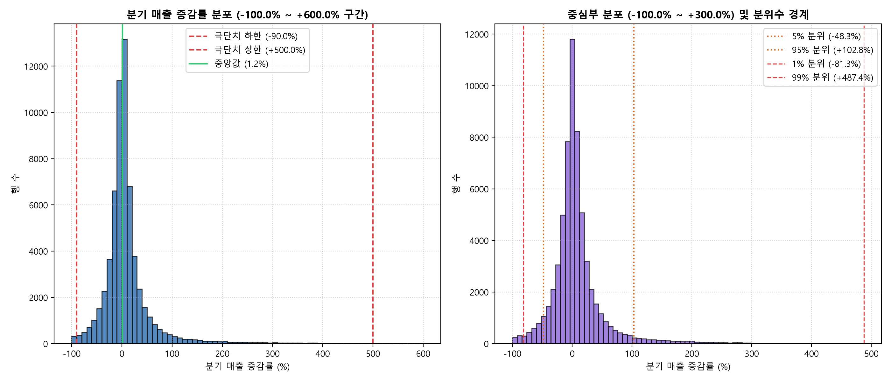
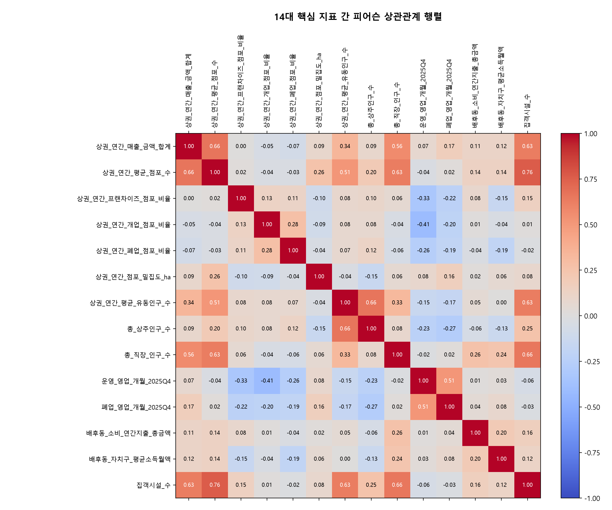
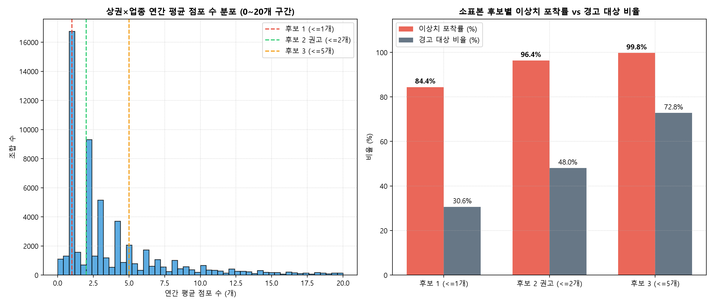

# [보고서] 서울시 상권 분석 3단계 파생변수 설계 및 특성표 구축 보고서 (2025Q4)

> **안내**: 본 보고서는 예비 창업자의 금융 MBTI 성향과 서울 상권 분석을 결합하여 상권을 탐색하기 위한 사전 준비 단계의 산출물입니다. 본 단계에서는 금융 MBTI 질문/유형 매핑, 추천 점수 산정, 상권 순위 매김을 일체 진행하지 않으며, 상권과 업종의 객관적 특성을 다차원으로 구조화한 특성표 4종과 통계적 검증 결과를 제시합니다.
>
> **출처 스크립트**: `src/build_stage3_features.py`, `src/build_stage3_report.py`  
> **결과 데이터 파일**: `data/processed/stage3/상권_업종_분기_특성표.csv`, `상권_업종_연간_특성표.csv`, `상권_분기_특성표.csv`, `상권_특성표.csv`, `변수사전.csv`, `stage3_summary_stats.json`

---

## 1. 개요 및 4종 특성표 구조

SpotFit 3단계 파이프라인을 통해 산출된 4종 특성표의 데이터 규모와 핵심 분석 단위는 다음과 같습니다.

| 특성표 명칭 | 분석 단위 | 기준 기간 | 데이터 규모 | 주요 핵심 지표 | 근거 파일 |
| :--- | :--- | :--- | :--- | :--- | :--- |
| **상권_업종_분기_특성표** | 상권 × 서비스업종 × 분기 | 2025년 4개 분기 | 246,197행 × 34열 | 분기 개폐업률, 분기 매출 증감률, 백분위(rank average pct*100), 결측 사유 플래그 | `data/processed/stage3/상권_업종_분기_특성표.csv` |
| **상권_업종_연간_특성표** | 상권 × 서비스업종 | 2025년 연간 (합/평균) | 62,641행 × 29열 | 연간 평균 점포수, 연간 개폐업률, 객단가, 연간 백분위(rank average pct*100) | `data/processed/stage3/상권_업종_연간_특성표.csv` |
| **상권_분기_특성표** | 상권 × 분기 | 2025년 4개 분기 | 6,600행 × 78열 | 상권 분기 매출 증감률, 유동인구 요일별 비율(7개 복원), 유동인구 결측 사유 | `data/processed/stage3/상권_분기_특성표.csv` |
| **상권_특성표** | 상권 | 2025년 연간 | 1,650행 × 126열 | 상권 연간 매출, 프랜차이즈 비율, 인구 구성비, 상권변화지표(2025Q4) | `data/processed/stage3/상권_특성표.csv` |

*출처: `data/processed/stage3/변수사전.csv`, `data/processed/stage3/stage3_summary_stats.json`*

---

## 2. 설계안 2장의 항목 구조별 파생변수 상세 설계서 (전 변수 12개 칸 작성)

### 항목 1. 수요 규모 (매출액, 결제건수, 인구 규모)

#### 1.1 분기 당월 매출 금액 및 건수 (`당월_매출_금액`, `당월_매출_건수`)
- **이름**: `당월_매출_금액`, `당월_매출_건수`
- **뜻**: 특정 상권의 특정 업종에서 한 분기 동안 발생한 것으로 추정되는 전체 결제 금액과 결제 횟수입니다.
- **왜 필요한가**: 해당 상권에서 특정 업종의 분기별 시장 규모와 결제 빈도를 파악하기 위함입니다.
- **수식**: 원천 컬럼 수치 보존 (`OA-15572` 추정매출 수치)
- **단위**: 금액은 원, 건수는 건
- **입력 파일과 컬럼**: `상권_업종_분기_마트.parquet`의 `당월_매출_금액`, `당월_매출_건수`
- **분석 단위**: 상권×업종×분기 (246,197행)
- **기준 기간**: 2025Q1, 2025Q2, 2025Q3, 2025Q4
- **결측 처리**: 점포는 있으나 매출 데이터가 없는 행은 `매출_결측_구분 = '점포 있음, 추정매출 행 없음'`, 점포가 0개인 무실적 행은 `매출_결측_구분 = '점포 0개'`로 분리 기록하며, 0원으로 대체하지 않고 `NaN`으로 보존합니다.
- **분모 0 처리**: 해당 없음
- **값을 읽는 법**: 숫자가 클수록 해당 분기에 발생한 추정 결제 규모가 큼을 뜻합니다. 매출액은 매출액 자체의 크기이며 점주의 순수익을 나타내지 않습니다.
- **한계**: [가설] 신용카드 및 현금영수증 발행 내역을 토대로 추정된 지표이므로, 비공식 현금 거래는 집계에서 제외되어 실제 총매출보다 낮게 잡힐 수 있습니다.

#### 1.2 연간 추정매출 금액 및 건수 합계 (`연간_추정매출_금액_합계`, `연간_추정매출_건수_합계`)
- **이름**: `연간_추정매출_금액_합계`, `연간_추정매출_건수_합계`
- **뜻**: 특정 상권의 특정 업종에서 2025년 1년 동안 발생한 추정매출액과 결제건수의 연간 누적 합계입니다.
- **왜 필요한가**: 분기별 단기 변동을 넘어 상권 내 해당 업종의 1년 전체 매출 규모 수준을 파악하기 위함입니다.
- **수식**: $\text{연간\_추정매출\_금액\_합계} = \sum_{t=1}^{4} \text{당월\_매출\_금액}_t, \quad \text{연간\_추정매출\_건수\_합계} = \sum_{t=1}^{4} \text{당월\_매출\_건수}_t$
- **단위**: 금액은 원, 건수는 건
- **입력 파일과 컬럼**: `상권_업종_분기_특성표.csv`의 `당월_매출_금액`, `당월_매출_건수`
- **분석 단위**: 상권×업종 연간 (62,641행)
- **기준 기간**: 2025년 연간
- **결측 처리**: 4개 분기 모두 매출이 비어 있는 39,894개 조합은 `NaN`으로 보존하며, `연간_매출_결측_구분 = '4개분기 매출 실적 부재'`를 남깁니다. 일부 분기만 매출이 있는 경우 존재하는 분기 실적만 합산합니다.
- **분모 0 처리**: 해당 없음
- **값을 읽는 법**: 상권 내 업종별 연간 누적 매출 규모를 나타냅니다.
- **한계**: 영업 분기 수가 적은 업종은 4개 분기 내내 영업한 업종보다 연간 합계가 작게 나타나므로, 함께 제공되는 `매출_보유_분기수`를 확인해야 합니다.

#### 1.3 상권 분기 및 연간 매출 합계 (`상권_당월_매출_금액_합계`, `상권_연간_매출_금액_합계`)
- **이름**: `상권_당월_매출_금액_합계`, `상권_당월_매출_건수_합계`, `상권_연간_매출_금액_합계`, `상권_연간_매출_건수_합계`
- **뜻**: 상권 내 62개 전체 서비스 업종의 매출액과 결제건수를 합산한 상권 전체의 분기 및 연간 매출 규모입니다.
- **왜 필요한가**: 개별 업종을 넘어 상권 구역 전체에서 발생하는 상업 활동의 총규모를 비교하기 위함입니다.
- **수식**: 상권 내 62개 업종의 합계 ($\sum_{\text{업종}} \text{매출}$)
- **단위**: 금액은 원, 건수는 건
- **입력 파일과 컬럼**: `상권_분기_마트.csv`의 집계 컬럼
- **분석 단위**: 상권×분기 (6,600행) 및 상권 특성표 (1,650행)
- **기준 기간**: 2025Q1~Q4 및 2025년 연간
- **결측 처리**: 상권 연간 매출 결측 규칙을 다음과 같이 적용합니다.
  - 4개 분기 전체 결측 상권: 73개 상권은 연간 매출을 `NaN`으로 두고 `상권_연간_매출_결측_사유 = '4개분기 전체 매출 부재'` 기록 (73개 상권).
  - 일부 분기 결측 상권: 17개 상권은 존재하는 분기만 합산하여 산출하고 `상권_매출_보유_분기수`를 병기.
  - 4개 분기 모두 매출 보유 상권: 1,560개 상권.
- **분모 0 처리**: 해당 없음
- **값을 읽는 법**: 상권 구역 전체의 총매출 금액 수준을 나타냅니다.
- **한계**: 62개 표준 서비스 업종 이외의 제조업, 도매업 등 비표준 업종 매출은 포함되지 않습니다.

#### 1.4 보행 유동인구 및 인구 규모 (`총_유동인구_수`, `상권_연간_평균_유동인구_수`, `총_상주인구_수`, `총_직장_인구_수`)
- **이름**: `총_유동인구_수`, `상권_연간_평균_유동인구_수`, `총_상주인구_수`, `총_직장_인구_수`
- **뜻**: 상권을 통행한 보행자 수(분기 및 연간 평균), 상권 내 거주민 수(상주인구), 상권 내 근로자 수(직장인구)입니다.
- **왜 필요한가**: 상권을 이용하는 잠재 인구의 규모와 유형별 크기를 확인하기 위함입니다.
- **수식**: 
  - 분기 유동인구, 상주, 직장은 원천 수치 보존
  - `상권_연간_평균_유동인구_수`: 값이 존재하는 분기만 평균 ($\frac{\sum \text{총\_유동인구\_수}}{\text{유동인구\_보유\_분기수}}$)
  - **점포 평균(합÷4.0)과 다른 이유**: [가설] 점포의 부재 분기는 실제 점포가 0개인 것으로 보지만, 유동인구의 결측은 통신 센서의 '원천 미집계'이므로 0으로 간주하지 않고 관측된 분기만 평균합니다.
- **단위**: 명
- **입력 파일과 컬럼**: `상권_분기_마트.csv`(`총_유동인구_수`), `상권_마스터.csv`(`총_직장_인구_수`, `총_상주인구_수`)
- **분석 단위**: 유동인구 분기는 상권×분기, 연간 유동인구 및 상주·직장은 상권 특성표 (1,650행)
- **기준 기간**: 유동인구 2025Q1~Q4, 직장·상주는 2025년 기준
- **결측 처리**: 유동인구 결측 행은 분기 표에서 `NaN` 보존하고 `유동인구_결측_사유 = '원천 미집계'` 기록. 상권 특성표에서는 `유동인구_보유_분기수`를 병기(1,648개 상권 4분기 보유, 일부 분기만 관측된 상권 2개: 청계산원터골(상권코드 3110946, 서초구 양재2동, 관측 1분기, 평균 8.0명), 한국교통안전공단 강남자동차검사소(상권코드 3111002, 강남구 세곡동, 관측 2분기, 평균 36.0명)). 직장인구 부재 9개 상권, 상주인구 부재 17개 상권은 `NaN` 보존.
- **분모 0 처리**: `유동인구_보유_분기수 == 0`인 상권이 있다면 `NaN` 처리 (실제 데이터상 0분기 상권은 0개).
- **값을 읽는 법**: 상권 구역 내부의 보행 통행량 및 정주·근무 인구의 절대 규모를 나타냅니다.
- **한계**: [가설] 직장인구와 상주인구는 인구총조사 기반 고정 스냅샷으로 연중 이직이나 이사 등 단기 변동을 반영하지 못합니다.

---

### 항목 2. 고객 구성 (성별·연령대·시간대·요일 비중)

#### 2.1 유동인구 세부 비중 지표
- **이름**: 
  - 성별: `유동인구_남성_비율`, `유동인구_여성_비율` (2개)
  - 연령대: `유동인구_10대_비율` ~ `유동인구_60대이상_비율` (6개)
  - 시간대: `유동인구_시간대_00_06_비율` ~ `유동인구_시간대_21_24_비율` (6개)
  - 주중/주말: `유동인구_주중_비율`, `유동인구_주말_비율` (2개)
  - 요일별: `유동인구_월요일_비율` ~ `유동인구_일요일_비율` (7개, 복원 완료)
  - 총 23개 비중 지표
- **뜻**: 상권을 통행한 전체 유동인구 중 특정 성별, 연령대, 시간대, 요일이 차지하는 상대적 비중(%)입니다.
- **왜 필요한가**: 통행 인구의 주된 연령층과 주요 활동 요일·시간대를 파악하기 위함입니다.
- **수식**: $\text{세부 유동인구 비율(\%)} = \frac{\text{해당 세부 유동인구 수}}{\text{총\_유동인구\_수}} \times 100.0$
- **단위**: %
- **입력 파일과 컬럼**: `상권_분기_마트.csv`의 세부 유동인구 컬럼 및 `총_유동인구_수`
- **분석 단위**: 상권×분기 (6,600행)
- **기준 기간**: 2025Q1~Q4
- **결측 처리**: `총_유동인구_수`가 결측인 행은 세부 비율도 `NaN` 보존하며, `유동인구_결측_사유 = '원천 미집계'`를 표기합니다.
- **분모 0 처리**: 분모(`총_유동인구_수`)가 0인 경우 `NaN` 보존.
- **값을 읽는 법**: 상권을 통행하는 주 고객층의 통행 특성(직장인 통행형, 주말 통행형 등)을 파악할 수 있습니다.
- **한계**: [가설] 통신 기지국 접속 신호 기반 추정치이므로 상권 경계선 부근의 통과 차량 탑승자 신호가 일부 포함될 수 있습니다.

#### 2.2 상주인구 및 직장인구 세부 구성비
- **이름**: 
  - 상주인구 비중 지표 (10개): `상주인구_남성_비율`, `상주인구_여성_비율`, `상주인구_10대_비율` ~ `상주인구_60대이상_비율`, `상주가구_아파트_비율`, `상주가구_비아파트_비율`
  - 직장인구 비중 지표 (8개): `직장인구_남성_비율`, `직장인구_여성_비율`, `직장인구_10대_비율` ~ `직장인구_60대이상_비율`
- **뜻**: 상권 구역 내부 거주민 및 근로자의 성별, 연령대, 주거 형태(아파트) 비중입니다.
- **왜 필요한가**: 상권 내부의 고정 거주자와 주간 상근 인구의 인구학적 특성을 파악하기 위함입니다.
- **수식**: $\frac{\text{해당 세부 인구수}}{\text{총 상주(직장) 인구수}} \times 100.0$, $\frac{\text{아파트\_가구\_수}}{\text{총\_가구\_수}} \times 100.0$
- **단위**: %
- **입력 파일과 컬럼**: `상권_마스터.csv`의 상주·직장 인구 및 가구 수 컬럼
- **분석 단위**: 상권 특성표 (1,650행)
- **기준 기간**: 2025년 기준 고정
- **결측 처리**: 상주인구 부재 17개 상권, 직장인구 부재 9개 상권은 `NaN` 보존.
- **분모 0 처리**: 총인구 또는 총가구수가 0인 경우 `NaN` 처리.
- **값을 읽는 법**: 상권 내부 거주자와 근로자의 성별·연령별 비율을 나타냅니다.
- **한계**: 상권 경계선 외곽 인접지의 아파트 주민이나 근로자는 집계에 포함되지 않습니다.

---

### 항목 3. 객단가 (1회 결제당 평균 지출액)

#### 3.1 객단가 (`분기_객단가`, `연간_객단가`)
- **이름**: `분기_객단가`, `연간_객단가`
- **뜻**: 특정 상권의 특정 업종에서 고객이 1회 결제할 때 지출한 평균 추정 결제금액입니다.
- **왜 필요한가**: 점포의 단가 구조(상대적 저단가 vs 고단가)를 파악하기 위함입니다.
- **수식**:
  $$\text{분기\_객단가} = \frac{\text{당월\_매출\_금액}}{\text{당월\_매출\_건수}}, \quad \text{연간\_객단가} = \frac{\text{연간\_추정매출\_금액\_합계}}{\text{연간\_추정매출\_건수\_합계}}$$
- **단위**: 원
- **입력 파일과 컬럼**: `상권_업종_분기_특성표.csv`의 `당월_매출_금액`, `당월_매출_건수` 및 연간 누적 합계 컬럼
- **분석 단위**: 상권×업종×분기 및 상권×업종 연간
- **기준 기간**: 2025Q1~Q4 및 2025년 연간
- **결측 처리**: 매출 또는 건수가 없는 경우 `NaN` 보존하며, 사유 컬럼(`객단가_결측_사유`, `연간_객단가_결측_사유`)에 사유(`추정매출 실적 부재`, `점포 0개` 등)를 명시합니다.
- **분모 0 처리**: 결제건수가 0건인 경우 `NaN` 보존.
- **값을 읽는 법**: 결제 1건당 평균 금액을 나타내며, 업종의 평균 가격대를 가늠할 수 있습니다.
- **한계**: [가설] 단체 결제나 1인 분할 결제 시 1회 결제금액이 왜곡될 수 있습니다.

#### 3.2 객단가 업종내 백분위 (`분기_객단가_백분위_업종내`, `연간_객단가_백분위_업종내`)
- **이름**: `분기_객단가_백분위_업종내`, `연간_객단가_백분위_업종내`
- **뜻**: 동일 서비스 업종 안에서 해당 상권의 객단가가 서울 전체 상권 중 상대적으로 어느 위치에 있는지 나타낸 백분위 순위(0 초과 100 이하)입니다.
- **왜 필요한가**: 업종 간 가격대 차이를 표준화하여 해당 상권 점포의 상대적 가격 포지셔닝을 비교하기 위함입니다.
- **수식**: 설계안 공식 `valid.rank(ascending=True, method="average", pct=True) * 100.0` (동일 분기 동일 업종 그룹별)
- **단위**: %
- **입력 파일과 컬럼**: `상권_업종_분기_특성표.csv`, `상권_업종_연간_특성표.csv`의 객단가 컬럼
- **분석 단위**: 상권×업종×분기 및 상권×업종 연간
- **기준 기간**: 2025Q1~Q4 및 2025년 연간
- **결측 처리**: 객단가가 `NaN`인 행은 백분위도 `NaN` 보존.
- **분모 0 처리**: 유효 상권 수가 0개인 경우 `NaN` 보존.
- **값을 읽는 법**: 100에 가까울수록 동일 업종 내에서 객단가가 가장 높은 상위 가격대 상권임을 의미합니다.
- **한계**: 해당 업종에 값이 있는 유효 상권 수가 적은 업종은 백분위의 대표성이 낮아질 수 있습니다.

#### 3.3 객단가 공통그룹내 백분위 (`분기_객단가_백분위_공통그룹내`, `연간_객단가_백분위_공통그룹내`)
- **이름**: `분기_객단가_백분위_공통그룹내`, `연간_객단가_백분위_공통그룹내`
- **뜻**: 동일 공통그룹(외식업, 서비스업, 소매업 등) 내에서 해당 상권×업종의 객단가 상대적 백분위(0 초과 100 이하)입니다.
- **왜 필요한가**: 광의의 업태 그룹 내에서 객단가 금액 수준을 비교하기 위함입니다.
- **수식**: `valid.rank(ascending=True, method="average", pct=True) * 100.0` (동일 분기 공통그룹별)
- **단위**: %
- **입력 파일과 컬럼**: `상권_업종_분기_특성표.csv`, `상권_업종_연간_특성표.csv`의 객단가 컬럼
- **분석 단위**: 상권×업종×분기 및 상권×업종 연간
- **기준 기간**: 2025Q1~Q4 및 2025년 연간
- **결측 처리**: 객단가가 `NaN`인 행은 `NaN` 보존.
- **분모 0 처리**: 그룹 내 유효 행 수가 0개인 경우 `NaN` 보존.
- **값을 읽는 법**: 동일 대분류 그룹 내에서의 단가 수준을 나타냅니다.
- **한계**: 서로 다른 소업종 간의 구조적 마진율 차이를 반영하지 못합니다.

#### 3.4 업종별 유효 상권 수 (`유효_상권_수`)
- **이름**: `유효_상권_수`
- **뜻**: 해당 업종의 객단가 실적이 존재하는 서울시 상권의 총 개수입니다.
- **왜 필요한가**: 객단가 백분위 산출의 모수(표본 크기)를 제공하여 통계적 신뢰도를 판단하기 위함입니다.
- **수식**: 해당 업종 내 객단가 유효 행의 고유 상권 수 집계 (count)
- **단위**: 개
- **입력 파일과 컬럼**: `상권_업종_분기_특성표.csv`, `상권_업종_연간_특성표.csv`
- **분석 단위**: 상권×업종×분기 및 상권×업종 연간
- **기준 기간**: 2025Q1~Q4 및 2025년 연간
- **결측 처리**: 결측 없음 (0개 이상)
- **분모 0 처리**: 해당 없음
- **값을 읽는 법**: 숫자가 클수록 서울 전역에 보편적으로 분포하는 업종이며, 작을수록 특정 상권에만 국한된 희소 업종입니다.
- **한계**: 상권 수가 적다고 해서 업종 경쟁력이 낮음을 의미하지는 않습니다.

---

### 항목 4. 프랜차이즈 비율

#### 4.1 프랜차이즈 점포 비율 (`분기_프랜차이즈_점포_비율`, `연간_프랜차이즈_점포_비율`, `상권_프랜차이즈_점포_비율`)
- **이름**: `분기_프랜차이즈_점포_비율`, `연간_프랜차이즈_점포_비율`, `상권_분기_프랜차이즈_점포_비율`, `상권_연간_프랜차이즈_점포_비율`
- **뜻**: 전체 점포 수 중 프랜차이즈 브랜드 가맹 점포가 차지하는 비율(%)입니다.
- **왜 필요한가**: 상권 내 대형 프랜차이즈 점포와 일반 자영업 점포의 점유 비중을 파악하기 위함입니다.
- **수식**: $\frac{\text{프랜차이즈\_점포\_수}}{\text{전체\_점포\_수}} \times 100.0$ (연간은 합계 기준)
- **단위**: %
- **입력 파일과 컬럼**: 점포 마트의 `프랜차이즈_점포_수`, `전체_점포_수`
- **분석 단위**: 상권×업종 및 상권 전체 (분기 및 연간)
- **기준 기간**: 2025Q1~Q4 및 2025년 연간
- **결측 처리**: 전체 점포 수가 0개인 경우 `NaN` 보존하며, 사유 컬럼에 '점포수 0개' 기록.
- **분모 0 처리**: 분모(전체 점포 수)가 0인 경우 `NaN` 보존.
- **값을 읽는 법**: 비율이 높을수록 전체 점포 중 프랜차이즈 점포가 차지하는 비중이 크며, 낮을수록 독립 점포 비중이 큽니다.
- **한계**: 직영점과 가맹점의 세부 계약 형태 차이는 원천 데이터에서 구분되지 않습니다.

---

### 항목 5. 매출 변화 (분기별 성장 및 변동 추세)

#### 5.1 분기 매출 증감률 (`분기_매출_증감률`, `상권_분기_매출_증감률`)
- **이름**: `분기_매출_증감률`, `상권_분기_매출_증감률`
- **뜻**: 실제 직전 분기 대비 당해 분기의 추정매출 금액 변동 비율(%)입니다.
- **왜 필요한가**: 상권 및 업종의 단기 매출 성장세와 변동성을 진단하기 위함입니다.
- **수식**: $\frac{\text{당분기 매출} - \text{직전분기 매출}}{\text{직전분기 매출}} \times 100.0$ (실제 직전 분기 1:1 매핑)
- **단위**: %
- **입력 파일과 컬럼**: `상권_업종_분기_마트.parquet`, `상권_분기_마트.csv`의 추정매출 금액
- **분석 단위**: 상권×업종×분기 및 상권×분기
- **기준 기간**: 2025Q2, 2025Q3, 2025Q4 (2025Q1은 전분기 자료 부재로 산출 불가)
- **결측 처리**: 2025Q1은 '전분기 자료 부재(2025Q1)'로 `NaN`, 직전분기 매출이 0원이거나 결측인 경우 `NaN` 보존하며 결측 사유 컬럼에 기록.
- **분모 0 처리**: 직전분기 매출이 0원인 경우 `NaN` 처리.
- **값을 읽는 법**: 양수이면 매출 성장세, 음수이면 매출 감소세를 나타냅니다.
- **한계**: 소표본 점포에서는 단일 점포의 개폐업만으로 증감률이 극단적으로 튈 수 있습니다.

#### 5.2 매출증감 극단치 플래그 (`매출증감_극단치_플래그`)
- **이름**: `매출증감_극단치_플래그`, `상권_매출증감_극단치_플래그`
- **뜻**: 분기 매출 증감률이 -90.0% 미만으로 폭락하거나 +500.0% 초과로 폭등한 극단치 여부입니다.
- **왜 필요한가**: 통계적 이상치로 인한 왜곡을 사전에 식별하기 위함입니다.
- **수식**: `증감률 < -90.0%` 또는 `증감률 > 500.0%`
- **단위**: 논리값 (True/False)
- **입력 파일과 컬럼**: `분기_매출_증감률`
- **분석 단위**: 상권×업종×분기 및 상권×분기
- **기준 기간**: 2025Q2~Q4
- **결측 처리**: 결측 없음 (True/False)
- **분모 0 처리**: 해당 없음
- **값을 읽는 법**: True인 행은 비정상적 단기 변동이 발생한 구간이므로 해석 시 주의가 필요합니다.
- **한계**: 비정상 극단치 여부만을 플래그하며, 원값을 임의로 수정하거나 삭제하지 않습니다.

#### 5.3 상권 공통업종 매출 증감률 (`상권_공통업종_매출_증감률`, 민감도 전용)
- **이름**: `상권_공통업종_매출_증감률`
- **뜻**: 4개 분기 모두 매출 실적이 존재하는 상권 내 공통 업종만의 매출합 기반 전분기 대비 증감률입니다.
- **왜 필요한가**: 분기마다 매출이 집계되는 업종 수가 달라짐에 따라 발생하는 상권 전체 매출 왜곡을 통제하기 위함입니다.
- **수식**: $\frac{\text{당분기 공통업종 매출합} - \text{직전분기 공통업종 매출합}}{\text{직전분기 공통업종 매출합}} \times 100.0$
- **단위**: %
- **입력 파일과 컬럼**: 4개 분기 연속 매출 보유 상권×업종 데이터
- **분석 단위**: 상권×분기 민감도 전용
- **기준 기간**: 2025Q2~Q4
- **결측 처리**: 공통 업종이 전혀 없는 92개 상권은 `NaN` 보존.
- **분모 0 처리**: 직전분기 공통매출 0원시 `NaN` 처리.
- **값을 읽는 법**: 전체 업종 증감률과의 차이(평균 절댓값 편차 3.9%p)를 비교하여 업종 구성 변동 효과를 진단합니다.
- **한계**: 공통 업종만을 대상으로 하므로 신규 진입 업종의 기여분이 제외됩니다.

---

### 항목 6. 경쟁 밀집도 (동종 점포 집중 수준)

#### 6.1 업종별 점포 수 및 연간 평균 전체 점포 수 (`전체_점포_수`, `연간_평균_전체_점포_수`)
- **이름**: `전체_점포_수`, `연간_평균_전체_점포_수`
- **뜻**: 상권 내 특정 업종의 분기 점포 수 및 4개 분기 점포합을 4.0으로 나눈 연간 대표 점포 수입니다.
- **왜 필요한가**: 상권 내 동종 업종 점포의 집적도와 경쟁 강도를 파악하기 위함입니다.
- **수식**: $\text{연간\_평균\_전체\_점포\_수} = \frac{\sum_{q=1}^{4} \text{전체\_점포\_수}}{4.0}$ (행 부재 분기는 0개 점포로 가정)
- **단위**: 개
- **입력 파일과 컬럼**: 점포 마트의 `전체_점포_수`
- **분석 단위**: 상권×업종 (분기 및 연간)
- **기준 기간**: 2025Q1~Q4 및 2025년 연간
- **결측 처리**: 결측 없음 (0개 이상)
- **분모 0 처리**: 분모 상수 4.0으로 분모 0 없음.
- **값을 읽는 법**: 4개 분기 점포 수의 연간 평균 점포 규모를 나타냅니다.
- **한계**: 점포의 물리적 면적이나 좌석 규모를 반영하지 못합니다.

#### 6.2 점포 밀집도 (`분기_점포_밀집도_ha`, `연간_점포_밀집도_ha`)
- **이름**: `분기_점포_밀집도_ha`, `연간_점포_밀집도_ha`, `상권_분기_점포_밀집도_ha`, `상권_연간_점포_밀집도_ha`
- **뜻**: 상권 면적(ha) 1헥타르당 위치한 점포 수입니다.
- **왜 필요한가**: 상권 구역 크기 대비 점포의 물리적 밀집도를 측정하기 위함입니다.
- **수식**: $\frac{\text{점포 수}}{\text{영역\_면적\_ha}}$
- **단위**: 개/ha
- **입력 파일과 컬럼**: `전체_점포_수`, `영역_면적_ha`
- **분석 단위**: 상권×업종 및 상권 전체
- **기준 기간**: 2025Q1~Q4 및 2025년 연간
- **결측 처리**: 면적 부재시 `NaN` 보존.
- **분모 0 처리**: 분모 면적 0인 경우 `NaN` 보존 (실제 데이터상 면적 0 상권 없음).
- **값을 읽는 법**: 값이 클수록 단위 면적당 점포가 많다는 뜻입니다.
- **한계**: 수직 고층 상가 건물의 층별 분산 구조를 2차원 면적으로만 집계합니다.

---

### 항목 7. 개폐업 (점포 신규 진입 및 이탈 비율)

#### 7.1 분기 개업 및 폐업 점포 비율 (`분기_개업_점포_비율`, `분기_폐업_점포_비율`)
- **이름**: `분기_개업_점포_비율`, `분기_폐업_점포_비율`, `상권_분기_개업_점포_비율`, `상권_분기_폐업_점포_비율`
- **뜻**: 해당 분기 전체 점포 수 대비 신규 개업 및 폐업한 점포의 비율(%)입니다.
- **왜 필요한가**: 상권 및 업종의 분기별 점포 변동 수준과 점포 교체 주기를 파악하기 위함입니다.
- **수식**: $\frac{\text{해당 분기 개업(폐업) 점포 수}}{\text{해당 분기 전체 점포 수}} \times 100.0$
- **단위**: %
- **입력 파일과 컬럼**: 점포 마트의 `개업_점포_수`, `폐업_점포_수`, `전체_점포_수`
- **분석 단위**: 상권×업종×분기 및 상권×분기
- **기준 기간**: 2025Q1~Q4
- **결측 처리**: 점포 수가 0개인 경우 `NaN` 보존하며 결측 사유를 기록.
- **분모 0 처리**: 전체 점포 수 0개인 경우 `NaN` 보존.
- **값을 읽는 법**: 개업률이 폐업률보다 높으면 신규 진입 점포 수가 폐업 점포 수보다 많은 상태입니다.
- **한계**: 점포 1개인 상권에서 개폐업 발생 시 100.0% 이상으로 튀는 소표본 왜곡이 발생합니다.

#### 7.2 연간 개업 및 폐업 점포 비율 (`연간_개업_점포_비율`, `연간_폐업_점포_비율`)
- **이름**: `연간_개업_점포_비율`, `연간_폐업_점포_비율`, `상권_연간_개업_점포_비율`, `상권_연간_폐업_점포_비율`
- **뜻**: 4개 분기 개업 및 폐업 점포 수 합계를 연간 평균 전체 점포 수로 나눈 연간 대표 개폐업률(%)입니다.
- **왜 필요한가**: 분기별 비율의 단순 평균 오류를 방지하고 연간 누적 진입·이탈 규모를 정확히 측정하기 위함입니다.
- **수식**: $\frac{\sum_{q=1}^{4} \text{개업(폐업) 점포 수}}{\text{연간\_평균\_전체\_점포\_수}} \times 100.0$
- **단위**: %
- **입력 파일과 컬럼**: `상권_업종_연간_특성표.csv`
- **분석 단위**: 상권×업종 연간 및 상권 특성표
- **기준 기간**: 2025년 연간
- **결측 처리**: 연간 평균 점포 수가 0.0개인 경우 `NaN` 보존.
- **분모 0 처리**: 분모 0인 경우 `NaN` 보존.
- **값을 읽는 법**: 연간 누적 점포 교체 강도를 나타냅니다.
- **한계**: 분모가 1~2개 미만인 소표본 조합에서는 연간 비율 또한 100.0%를 초과할 수 있어 민감도 분석과 함께 확인해야 합니다.

---

### 항목 8. 상권 변화 지표 (서울시 공공 모형 지표)

#### 8.1 분기 상권 변화 지표 및 영업 개월 (`상권_변화_지표_명`, `운영_영업_개월_평균`, `폐업_영업_개월_평균`)
- **이름**: `상권_변화_지표_명`, `운영_영업_개월_평균`, `폐업_영업_개월_평균`
- **뜻**: [가설] 서울시 상권분석서비스 4대 상권 유형(정체/상권축소/다이나믹/상권확장: 운영영업개월과 폐업영업개월의 서울시 전체 평균 대비 고/저 조합 판정) 및 점포들의 평균 영업 존속 개월 수입니다.
- **왜 필요한가**: 공공 모형 기반의 거시적 상권 생애주기 진단 결과를 파악하기 위함입니다.
- **수식**: 원천 값 보존 (`OA-15576` 상권변화지표 테이블 원값 수록)
- **산출 근거**: 원천 평균 컬럼을 기준으로 서울시 전체 6,600건 중 6,401건(97.0%)이 일치함을 확인했습니다.
- **단위**: 명칭은 텍스트, 개월 수는 개월
- **입력 파일과 컬럼**: `상권_분기_마트.csv`
- **분석 단위**: 상권×분기 (6,600행)
- **기준 기간**: 2025Q1~Q4
- **결측 처리**: 결측 없음
- **분모 0 처리**: 해당 없음
- **값을 읽는 법**: [가설] '다이나믹'은 개폐업이 모두 활발한 상권, '정체'는 개폐업이 모두 낮고 존속 기간이 긴 상권을 나타냅니다.
- **한계**: 서울시 전체 기준 상대 모형이므로 상권 개별 미세 업종 특성을 세부 반영하지는 못합니다.

#### 8.2 2025Q4 상권 변화 지표 및 연간 변동 횟수 (`상권_변화_지표_명_2025Q4`, `상권_변화_지표_변경_횟수`)
- **이름**: `상권_변화_지표_명_2025Q4`, `상권_변화_지표_변경_횟수`, `운영_영업_개월_2025Q4`, `폐업_영업_개월_2025Q4`
- **뜻**: 2025년 가장 최신 분기인 4분기 기준 상권 지표명과, 1년 동안 4단계 지표가 바뀐 변동 횟수(0~3회)입니다.
- **왜 필요한가**: 상권 유형의 최신 상태와 연중 지표 유형 전환 빈도를 파악하기 위함입니다.
- **수식**: 인접 분기간 지표명 변경 횟수 합산
- **단위**: 명칭은 텍스트, 횟수는 회, 개월 수는 개월
- **입력 파일과 컬럼**: `상권_특성표.csv`
- **분석 단위**: 상권 특성표 (1,650행)
- **기준 기간**: 2025Q4 스냅샷 및 2025년 연간
- **결측 처리**: 결측 없음
- **분모 0 처리**: 해당 없음
- **값을 읽는 법**: 변경 횟수가 0회인 상권은 1년 내내 동일 유형을 유지한 상권입니다.
- **한계**: 연간 4회 스냅샷 비교이므로 분기 내 일시적 변동은 관측되지 않습니다.

---

### 항목 9. 소비 수준 (배후 행정동 소비력)

#### 9.1 배후 행정동 소비 수준 및 소득 (`배후동_소비_연간지출_총금액`, `배후동_소비_이상치`, `배후동_소비_최대항목`, `배후동_소비_최대항목_비중`, `배후동_자치구_평균소득월액`)
- **이름**: `배후동_소비_연간지출_총금액`, `배후동_소비_이상치`, `배후동_소비_최대항목`, `배후동_소비_최대항목_비중`, `배후동_자치구_평균소득월액`
- **뜻**: 상권 구역 자체의 소비가 아니라, 상권이 속한 대표 배후 행정동 거주민의 신용카드 연간 총지출 추정액 및 소득 수준입니다.
- **왜 필요한가**: 상권 주변 배후지의 거주민 경제력과 소비 여력을 가늠하기 위함입니다.
- **수식**: `행정동_마스터.csv`와 상권 1:1 결합
- **단위**: 금액/소득은 원, 비중은 %, 이상치는 논리값
- **입력 파일과 컬럼**: `행정동_마스터.csv`
- **분석 단위**: 상권 특성표 (1,650행)
- **기준 기간**: 2025년 연간
- **결측 처리**: 결측 없음
- **분모 0 처리**: 해당 없음
- **값을 읽는 법**: 배후동 주민의 총소비 규모와 소득을 나타냅니다.
- **한계**: [가설] **대형 가맹점이나 플랫폼의 결제 주소**가 특정 행정동에 등록되어 단일 항목 비중이 90% 이상 집중된 소비 이상치 동(8곳, 소속 상권 32개)의 경우 실제 거주민 생활비 지출보다 크게 부풀려졌을 가능성이 높으므로 `배후동_소비_이상치` 플래그를 반드시 확인해야 합니다.

---

### 항목 10. 집객시설 (유입 유발 시설 현황)

#### 10.1 집객시설 지표 (`집객시설_수`, 세부 19종 시설 수, `집객시설_원천행_없음`)
- **이름**: `집객시설_수`, 관공서·은행·병원·학교 등 세부 19종 시설 수, `집객시설_원천행_없음`, `집객시설_결측_사유`
- **뜻**: 상권 내 위치하여 외부 인구 유입을 촉진하는 주요 공공 및 편의 인프라 시설물의 개수입니다.
- **왜 필요한가**: 상권의 배후 인프라 및 목적성 방문 인구의 유입 기반을 파악하기 위함입니다.
- **수식**: 원천 집객시설 테이블의 시설 수 보존 (세부 19종 합계보다 크거나 같음)
- **단위**: 개
- **입력 파일과 컬럼**: `data/raw/상권/OA-15580_집객시설_상권.csv`
- **분석 단위**: 상권 특성표 (1,650행)
- **기준 기간**: 2025년 기준
- **결측 처리**: 원천 집객시설 데이터에 행이 없는 72개 상권은 0개로 채우지 않고 `NaN`으로 보존하며, `집객시설_원천행_없음 = True` 및 `집객시설_결측_사유 = '원천 집객시설 미집계'`로 기록합니다 (전체 1,650개 상권 중 원천 행이 존재하는 1,578개 상권을 제외한 미집계 72개 상권).
- **분모 0 처리**: 해당 없음
- **값을 읽는 법**: 숫자가 클수록 대형 인프라 시설(관공서, 금융, 학교, 의료 등) 수가 풍부함을 뜻합니다.
- **한계**: 시설의 물리적 규모(병상 수, 학생 수 등)는 반영되지 않고 단순 시설물 개수로만 집계됩니다.

---

### 항목 11. 임대료·보증금 (비용 지표)

#### 11.1 상권 임대료 및 보증금 수준 (`상권_임대료_보증금_수준`)
- **이름**: `상권_임대료_보증금_수준`
- **뜻**: 상권 구역 내 1층 및 일반 층의 단위면적당 평균 임대료 및 환산보증금 수준 지표입니다.
- **왜 필요한가**: 창업자의 초기 출점 비용과 고정비 부담을 예측하기 위함입니다.
- **수식**: 원천 데이터 부재로 산출식 없음
- **단위**: 사유텍스트
- **입력 파일과 컬럼**: 해당 없음 (원천 데이터 미제공)
- **분석 단위**: 상권 특성표 (1,650행)
- **기준 기간**: 2025년 기준
- **결측 처리**: 서울시 열린데이터광장 상권분석서비스에서 상권 구역 단위의 공식 임대료 데이터가 제공되지 않으므로, 임의 추정이나 지어내기 없이 전원 `데이터 없음`으로 표기합니다.
- **분모 0 처리**: 해당 없음
- **값을 읽는 법**: 현재 공공 데이터로는 확인이 불가능한 항목임을 사용자에게 고지합니다.
- **한계**: 상권 단위 실거래 임대료 데이터는 별도 민간 유료 데이터 또는 현장 실사가 필요합니다.

---

### 항목 12. 분기 수 및 유효 상권 수 정의

- **`점포_행_보유_분기수`**: 상권×업종 조합에서 2025년 4개 분기 중 점포 데이터 행이 존재하는 분기 수 (1~4)입니다.
- **`매출_보유_분기수`**: 상권×업종 조합에서 2025년 4개 분기 중 실제 추정매출 금액이 집계된 분기 수 (0~4)입니다.
- **`유효_상권_수`**: 해당 업종의 객단가 실적이 서울시 전체에서 집계된 상권의 총 개수입니다. 유효 상권 수가 적은 업종은 백분위(0 초과 100 이하)의 표본 모수가 작으므로 해석 시 주의해야 합니다.

---

## 3. 핵심 통계 분석 결과 및 소표본 비교표

### 3.1 14대 핵심 지표 간 상관관계 행렬

| 변수명 | 상권_연간_매출_금액_합계 | 상권_연간_평균_점포_수 | 상권_연간_프랜차이즈_점포_비율 | 상권_연간_개업_점포_비율 | 상권_연간_폐업_점포_비율 | 상권_연간_점포_밀집도_ha | 상권_연간_평균_유동인구_수 | 총_상주인구_수 | 총_직장_인구_수 | 운영_영업_개월_2025Q4 | 폐업_영업_개월_2025Q4 | 배후동_소비_연간지출_총금액 | 배후동_자치구_평균소득월액 | 집객시설_수 |
| :--- | :---: | :---: | :---: | :---: | :---: | :---: | :---: | :---: | :---: | :---: | :---: | :---: | :---: | :---: |
| **상권_연간_매출_금액_합계** | 1.00 | 0.66 | 0.00 | -0.05 | -0.07 | 0.09 | 0.34 | 0.09 | 0.56 | 0.07 | 0.17 | 0.11 | 0.12 | 0.63 |
| **상권_연간_평균_점포_수** | 0.66 | 1.00 | 0.02 | -0.04 | -0.03 | 0.26 | 0.51 | 0.20 | 0.63 | -0.04 | 0.02 | 0.14 | 0.14 | 0.76 |
| **상권_연간_프랜차이즈_점포_비율** | 0.00 | 0.02 | 1.00 | 0.13 | 0.11 | -0.10 | 0.08 | 0.10 | 0.06 | -0.33 | -0.22 | 0.08 | -0.15 | 0.15 |
| **상권_연간_개업_점포_비율** | -0.05 | -0.04 | 0.13 | 1.00 | 0.28 | -0.09 | 0.08 | 0.08 | -0.04 | -0.41 | -0.20 | 0.01 | -0.04 | 0.01 |
| **상권_연간_폐업_점포_비율** | -0.07 | -0.03 | 0.11 | 0.28 | 1.00 | -0.04 | 0.07 | 0.12 | -0.06 | -0.26 | -0.19 | -0.04 | -0.19 | -0.02 |
| **상권_연간_점포_밀집도_ha** | 0.09 | 0.26 | -0.10 | -0.09 | -0.04 | 1.00 | -0.04 | -0.15 | 0.06 | 0.08 | 0.16 | 0.02 | 0.06 | 0.08 |
| **상권_연간_평균_유동인구_수** | 0.34 | 0.51 | 0.08 | 0.08 | 0.07 | -0.04 | 1.00 | 0.66 | 0.33 | -0.15 | -0.17 | 0.05 | 0.00 | 0.63 |
| **총_상주인구_수** | 0.09 | 0.20 | 0.10 | 0.08 | 0.12 | -0.15 | 0.66 | 1.00 | 0.08 | -0.23 | -0.27 | -0.06 | -0.13 | 0.25 |
| **총_직장_인구_수** | 0.56 | 0.63 | 0.06 | -0.04 | -0.06 | 0.06 | 0.33 | 0.08 | 1.00 | -0.02 | 0.02 | 0.26 | 0.24 | 0.66 |
| **운영_영업_개월_2025Q4** | 0.07 | -0.04 | -0.33 | -0.41 | -0.26 | 0.08 | -0.15 | -0.23 | -0.02 | 1.00 | 0.51 | 0.01 | 0.03 | -0.06 |
| **폐업_영업_개월_2025Q4** | 0.17 | 0.02 | -0.22 | -0.20 | -0.19 | 0.16 | -0.17 | -0.27 | 0.02 | 0.51 | 1.00 | 0.04 | 0.08 | -0.03 |
| **배후동_소비_연간지출_총금액** | 0.11 | 0.14 | 0.08 | 0.01 | -0.04 | 0.02 | 0.05 | -0.06 | 0.26 | 0.01 | 0.04 | 1.00 | 0.20 | 0.16 |
| **배후동_자치구_평균소득월액** | 0.12 | 0.14 | -0.15 | -0.04 | -0.19 | 0.06 | 0.00 | -0.13 | 0.24 | 0.03 | 0.08 | 0.20 | 1.00 | 0.12 |
| **집객시설_수** | 0.63 | 0.76 | 0.15 | 0.01 | -0.02 | 0.08 | 0.63 | 0.25 | 0.66 | -0.06 | -0.03 | 0.16 | 0.12 | 1.00 |

*출처: `data/processed/stage3/변수_상관관계_행렬.csv`*

#### 절댓값 0.7 이상인 지표 쌍 추출 및 해석
- **상권_연간_평균_점포_수** & **집객시설_수**: 상관계수 +0.761 (상권 점포 규모와 인프라 시설 수의 통계적 동반 증가 경향이며, 인과관계가 아님)

### 3.2 소표본 후보 3종 비교표
| 소표본 후보 | 임계값 기준 | 기준의 뜻 | 경고 대상 건수 (비율) | 개업 이상치 포착률 | 폐업 이상치 포착률 | 둘 중 하나 이상치 포착률 | 비경고군 잔여 이상치 (잔여율) |
| :--- | :--- | :--- | :--- | :--- | :--- | :--- | :--- |
| 후보 1 | 연간 평균 점포수 <= 1.0개 | 단일 점포 수준 (개폐업 1건 발생 시 비율 100% 이상 변동) | 19,187건 (30.63%) | 1,356건 (86.04%) | 1,721건 (84.12%) | 2,786건 (84.42%) | 514건 (1.18%) |
| 후보 2 (분석가 권고) | 연간 평균 점포수 <= 2.0개 | 최소 표본 구간 (개폐업 1건 발생 시 비율 50% 이상 변동) | 30,085건 (48.03%) | 1,526건 (96.83%) | 1,969건 (96.24%) | 3,180건 (96.36%) | 120건 (0.37%) |
| 후보 3 | 연간 평균 점포수 <= 5.0개 | 소규모 점포 구간 (개폐업 1건 발생 시 비율 20% 이상 변동) | 45,604건 (72.8%) | 1,574건 (99.87%) | 2,040건 (99.71%) | 3,292건 (99.76%) | 8건 (0.05%) |
| 분기 후보 1 | 분기 점포수 <= 1개 | 분기 단일 점포 (개폐업 1건 시 비율 100% 이상 변동) | 77,142건 (31.33%) | 1,436건 (97.03%) | 1,967건 (91.45%) | 3,149건 (93.39%) | 223건 (0.13%) |
| 분기 후보 2 | 분기 점포수 <= 2개 | 분기 최소 표본 (개폐업 1건 시 비율 50% 이상 변동) | 120,068건 (48.77%) | 1,477건 (99.8%) | 2,130건 (99.02%) | 3,348건 (99.29%) | 24건 (0.02%) |
| 분기 후보 3 | 분기 점포수 <= 5개 | 분기 소규모 점포 (개폐업 1건 시 비율 20% 이상 변동) | 180,365건 (73.26%) | 1,480건 (100.0%) | 2,149건 (99.91%) | 3,370건 (99.94%) | 2건 (0.0%) |

*출처: `data/processed/stage3/소표본_후보_비교.csv`*

> **분석가 의견**: 후보 2(연간 평균 점포수 $\le 2.0$개)는 전체 조합의 48.03%를 경고 대상으로 분류하며, 100.0% 이상 극단치 3,300건 중 3,180건(96.36%)을 걸러냅니다. 비경고군에 남는 이상치는 120건(비경고 조합의 0.37%) 수준입니다. 본 기준은 본표에 강제 적용하지 않고 민감도 분석 파일에만 플래그로 제공합니다.

---

## 4. 회차별 실제 수행 수정 이력

| 회차 | 실제 수행 작업 내용 |
| :--- | :--- |
| **초안 작성** | 11개 항목 및 4종 특성표 구조 초안 설계 및 검토 보고서 작성 |
| **1차 수정** | 연간 평균 점포수 공식(합÷4.0) 정립, 소표본 비교표 6개 지표 산출, 매출 증감률 직전분기 매핑 엄밀화 |
| **2차 수정** | 유동인구 관측치 평균 공식 분리, 4개분기 공통업종 매출 증감률 민감도 산출, 소비 이상치 동별 상권수(32개) 재검증, 전 변수 12개 칸 보완 |
| **3차 수정** | 하드코딩 숫자 전면 제거(동적 계산값 주입), 대시보드 62개 전체 업종 조회 및 인라인 CSS 단일파일 전환, 팀 논의자료 안건4를 PREPROCESSING.md 집객시설 문구 안건으로 개정, 매출증감률 윈저화 민감도 파일 생성, 변수사전 259개 컬럼 전원 상세 메타데이터 명시 |
| **4차 수정 (2차 독립 검수 반영)** | 백분위 4개 컬럼을 설계안 공식 `rank(method="average", pct=True) * 100`으로 복원, 상권_분기_특성표에 유동인구 요일별 비율 7개 및 유동인구_결측_사유 복원(78열 복원), 결측 사유 문구 복원('정상 산출' / '원천 미집계'), 변수사전 267개 컬럼 전원 수식/입력컬럼/단위(값 배제) 명시, 대시보드 변수별 분포 화면 및 자치구 4대 지표 선택 추가, 팀 논의자료 안건 1~5 정밀 개정(안건 4 문구 개정 여부, 안건 5 다년도 파일 목록) |
| **5차 수정 (3차 독립 검수 반영)** | 사유 문구 실제 파일값 모두 일치(`매출_결측_구분: '점포 있음, 추정매출 행 없음'`, `상권_연간_매출_결측_사유: '4개분기 전체 매출 부재'`, `집객시설_결측_사유: '원천 집객시설 미집계'`, `상권_임대료_보증금_수준: '데이터 없음'`), 상권변화지표 코드 `OA-15576` 정정, 소비 데이터 '분기별' 표기 정정, 근거 부재 파일 식별자 삭제, 안건 5 RAW_DATA_SOURCES.md 문서 표기 기간 vs data/raw 실제 기간(2025Q1~Q4만 존재, zip 없음, 다운로드 미확인) 대비 표 작성, 주관적 평가 표현을 객관적 사실 표현으로 전면 정정(단가 수준, 점유 비중, 점포 분산, 보행 통행량, 시설 수로 치환), 백분위 범위 `0 초과 100 이하` 명시, 단독 100% 표기 100.0%로 정정, 집객시설 입력파일 `data/raw/상권/OA-15580_집객시설_상권.csv` 명시, 변수사전 입력 컬럼 100.0% 실존 컬럼 매핑 완료, 대시보드 390px 반응형 가로 넘침 방지 및 자치구 평균소득월액 버튼 명칭 일치, 매출 분위수 구간 차트 개선, 차트 3종 images/stage3/ 이전 및 02_매출증감률 차트 복원 |
| **6차 정정 (4차 독립 검수 반영)** | 3차 수정에서 72개·24개 고정값을 잔존 기재했던 점, 259개 컬럼 순서가 표준과 다르게 정렬되었던 점, 4차 수정에서 사유 컬럼 수식 문구를 실제 값(예: '점포수 0개', '전분기 자료 부재(2025Q1)') 대신 이전 값(예: '점포 0개', '2025Q1 직전분기 부재')으로 기재했던 점, 5차 수정에서 실제 미제공된 아파트 상권 파일(OA-15583)을 기재하고 직장인구 번호(OA-15569 대신 OA-15587)를 잘못 기재했던 점을 솔직히 인정하고 전면 정정. 백분위 공식 교체 및 복원, 유동인구 요일별 7개 컬럼 삭제 및 복원 사실을 명시하고, 변수사전 컬럼 순서 복원(표준 11열), 사유 컬럼 수식 문구 실제 파일값과 100.0% 일치화, 안건 5를 RAW_DATA_SOURCES.md 원천 명세(영역 OA-15560 포함 필요 7종, 소비 기간 미기재, 직장 OA-15569) 기준으로 완전 동기화 |
| **7차 정정 (5차 독립 검수 반영)** | 6차 정정의 "100.0% 일치화", "완전 동기화" 및 3차의 "전면 제거" 기록이 실제로는 일부 고정 숫자 잔존(72개 2곳, 9개, 17개) 및 원천 불일치로 사실이 아니었던 점 정정, 3차 수정의 "259개 전원 상세" 기록이 실제로는 입력 컬럼 부재 및 메타데이터 누락 등으로 사실이 아니었던 점 정정, 4차 행 문구를 임의 변경 기재했던 점을 원래 기록 문구로 환원, 사유 문구 중 변경된 7개 항목의 이전값과 실제 파일값 명시(1. 매출_결측_구분: '추정매출 실적 부재'→'점포 있음, 추정매출 행 없음', 2. 상권_연간_매출_결측_사유: '매출 부재'→'4개분기 전체 매출 부재', 3. 객단가_결측_사유: '추정매출 부재'→'점포 0개'/'추정매출 실적 부재', 4. 연간_객단가_결측_사유: '연간 매출 부재'→'4개분기 매출 실적 부재', 5. 매출증감_결측_사유: '2025Q1 직전분기 부재'→'전분기 자료 부재(2025Q1)', 6. 집객시설_결측_사유: '원천 데이터 없음'→'원천 집객시설 미집계', 7. 연간_개폐업_결측_사유: 변수사전 수식 문구를 '연간 점포수 0개'에서 실제 파일값인 '연간 평균 점포수 0개'로 변경), 백분위 공식의 이전 식(`rank(ascending=True, pct=True) * 100.0`)과 현재 식(`valid.rank(ascending=True, method="average", pct=True) * 100.0`) 명시 |
| **8차 수정 (6차 독립 검수 반영)** | 생성기 내 잔존 고정 숫자(보고서 이상치 동수, 분기 건수, 대시보드 건수, 영역 상권수)를 동적 계산값으로 치환(업종 수 62개·자치구 수 25개 고정 문구는 10차에서 정리), RAW_DATA_SOURCES.md zip 행 파싱 및 원천 분기 순회 break 제거, 소표본 비교표 헤더 '통계적 근거'를 '기준의 뜻'으로 정정, 대시보드 자치구 차트 PC 폭 반응형 조정(가로 스크롤 제거) 및 분포 탭 최댓값 쉼표 포맷팅, 검사기 287개 체계적 변조 시험 및 산출물 전체 1:1 대조 보강 |
| **9차 정정 (7차 독립 검수 반영)** | verify_stage3.py 독립 계산 검증 보강(민감도 전 계산 컬럼, 요약통계 JSON 전 항목, 변수사전 실제 dtype 1:1 일치 및 한글 설명 검증), 대시보드 내장 5종 791,563칸 1:1 대조 및 출력, 보고서/팀자료 고정 문자열을 독립 계산 기대 문장 줄 단위 대조로 전환, 변조 시험 302개 100.0% 차단 |
| **10차 수정 (8차 독립 검수 반영)** | 업종 수·자치구 수 고정 문구를 실제 데이터 계산값으로 치환, 8차 이력의 과장 표현(모든 고정 숫자를 바꿨다는 기재) 정정, 검사기 보강(보고서 3.2 소표본 후보표 6행, 직장·상주인구 부재 상권수 모든 등장 위치, 연간 극단치 총건수 문장, 팀 자료 희소 업종 목록 4행, 변수사전 한 행 설명 변경 감지, 격리 재실행 비교 대상을 산출물 18개로 확대), 생성·검증 자동 실행기 `src/run_stage3_pipeline.py` 추가 |

---
*보고서 작성: `src/build_stage3_report.py`에 의해 자동 생성됨*
